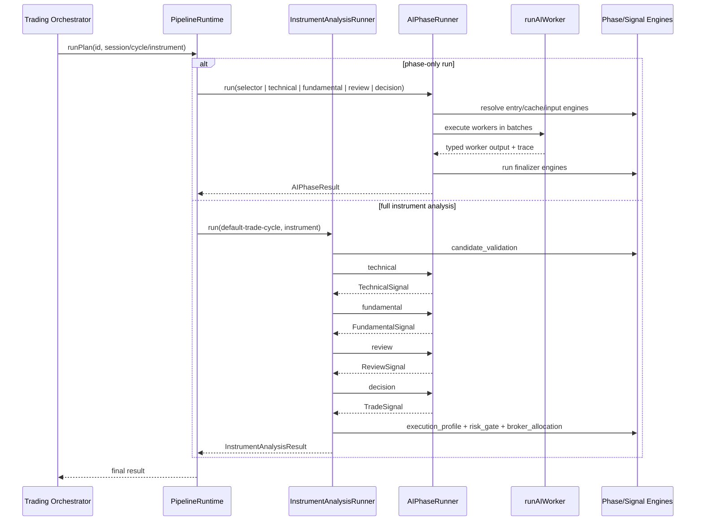

# pipeline

Runs Exva's AI analysis pipeline. It can run one AI phase by itself, or run one instrument through the full trade analysis path from validation to technical, fundamental, review, decision, and deterministic risk checks.

## How it works

- Entry point: `core/pipeline-runtime.ts`.
- `PipelineRuntime.runAIPhase()` runs one named phase such as `selector`, `technical`, `fundamental`, `review`, or `decision`.
- `PipelineRuntime.runCycle()` runs one instrument through an `InstrumentAnalysis`; the current production analysis id is `default-trade-cycle`.
- `PipelineRuntime.runPlan()` is the compatibility dispatcher that accepts either a phase id or an instrument-analysis id and routes to the right runner.
- `phases/` owns the generic `AIPhaseRunner`; it resolves phase engine IDs, runs worker batches, handles cache reads/writes, and persists aggregate traces.
- `analysis/` owns the generic `InstrumentAnalysisRunner`; it sequences phase calls and deterministic engine steps for one selected instrument.
- `execution/` owns the single-worker path: resolve provider/model, build prompts, assemble tools, invoke the LLM adapter, validate output, assemble traces, and track AI spend.
- `prompting/` builds the trusted system/user messages passed into each worker from prompt markdown, strategy facts, preset guidance, engine context, and task payload.
- `worker-tools/` turns configured tool ids into callable tools like `search_web`, `fetch_url`, `get_quote`, `get_ohlcv`, and terminal submit-output tools.
- `engines/` owns the phase-engine registry for phase-level hooks: input context, entry modes, cache policies, and finalizers.
- `definitions/` is the executable phase home: one `AIPhase` per phase, plus `phase-catalog.ts` for static metadata used by effective-config tooling.
- `implementations/` is the trade-cycle instrument analysis layer: `default-trade-cycle` sequence, signal-engine input builders, and analysis registration.
- `worker-prompts.ts` is the bundled prompt text source for phase workers.
- Deterministic signal engines are part of the pipeline contract. Worker-level `ENGINE_BINDINGS` enrich prompts before a worker call; phase finalizer engines in `engines/finalizer/` aggregate worker output; instrument-analysis engine steps run risk/allocation gates after the decision phase.

## Boot

At app startup (`app-services.ts`):

1. `registerDefaultEngines()` — signal engines for risk, validation, policy gates
2. `registerAllPhases()` — registers all five `AIPhase` objects from `definitions/`
3. `registerDefaultInstrumentAnalyses()` — registers `default-trade-cycle`
4. `assertValidPipelineDefinitionCatalog()` — validates workers, tools, and engine bindings

## Flow

## Terms

- **AIPhase** - executable definition of one named AI phase: `entryEngineIds`, `inputEngineIds`, `cacheEngineId`, worker batches, `finalizeEngineIds`, and optional output filter.
- **InstrumentAnalysis** - ordered analysis for one selected instrument. It mixes AI phases with deterministic engine steps and returns accumulated state.
- **WorkerDefinition** - static metadata for one AI worker: prompt, tools, strategy context request, output mode, and output schema.
- **PipelineRuntime** - composition root that injects repos, provider registries, search/broker dependencies, strategy context, spend tracking, and tool context into the runners.
- **Phase engine** - registered phase-level hook under `pipeline/engines`: input context, entry mode, cache, or finalizer.
- **Signal engine** - deterministic code under `services/signal/` that reads task input and returns typed results without calling an LLM. Worker-level `ENGINE_BINDINGS` remain separate from the new phase-engine registry.
- **ResearchDiscoveryMode** - session strategy field (`trend_scan` or `event_contract_scan`) that selects worker sets via each phase's `resolveWorkersForMode`.
- **Cycle id** - current runtime identifier for one trading-loop tick. Some code still uses `cycle` naming because the trading loop owns the outer tick.
