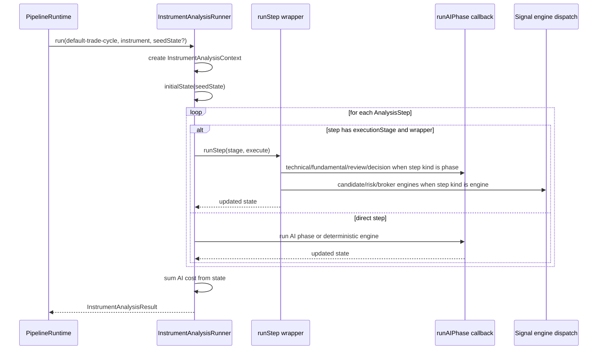

# pipeline/analysis

Runs one selected instrument through the full trade-analysis sequence. It takes an instrument the selector already chose and walks it through deterministic validation, AI phases, and final risk/broker gates.

## How it works

- `interpreter.ts` exports `InstrumentAnalysisRunner`, which executes an `InstrumentAnalysis` one step at a time.
- `types.ts` defines the analysis contracts: `InstrumentAnalysis`, `AnalysisStep`, `InstrumentAnalysisContext`, `InstrumentAnalysisState`, and `InstrumentAnalysisResult`.
- `stage-runner.ts` adapts declarative step configs from `implementations/trade/default-analysis-steps.ts` into executable steps.
- `registry.ts` stores instrument analyses registered during app startup.
- `services.ts` lists the deterministic services available to analysis steps, including stats, session repos, broker routing, normalizers, and strategy context.
- The runner builds a context with the selected instrument, session config, effective instrument classes, strategy context, worker tool context, services, and a `runAIPhase` callback supplied by `PipelineRuntime`.
- State starts from `initialState(ctx, seedState)`. The seed is used by callers that need to resume or test a partial analysis.
- Steps run sequentially. There is no worker-level concurrency here; concurrency lives inside the individual AI phases.
- AI steps call `ctx.runAIPhase(phase, input)`, which loads the registered `AIPhase` from `phases/registry.ts` (populated by `definitions/index.ts`) and runs it through `AIPhaseRunner`.
- Engine steps call deterministic signal engines through `stage-runner.ts` and `execution/stage-dispatch.ts` (`candidate_validation`, `risk_gate` chain).
- Required steps abort the full analysis when they throw. Optional steps can fail without stopping the analysis unless the thrown error is a control error.
- `runStep` lets the outer orchestration layer wrap each logical execution stage for progress tracking, retry handling, pause-after-step behavior, and failure persistence.
- `lastStageId` allows a caller to stop after a named step, which is useful for debugging or controlled partial execution.
- The result includes the final `InstrumentAnalysisState` plus `totalAiCostUsd`, calculated from LLM run records stored in the state.

## Flow

## Terms

- **InstrumentAnalysis** - ordered definition for analyzing one instrument.
- **AnalysisStep** - one sequential operation in an instrument analysis, either an AI phase call or a deterministic engine call.
- **InstrumentAnalysisState** - accumulated outputs: quote snapshot, AI signals, execution profile, risk order, broker allocation, and broker account id.
- **runStep** - optional wrapper used by orchestration to add retries, persisted progress, pause behavior, and failure handling around a step.
- **seedState** - optional partial state used to start from existing data instead of an empty state.
- **control error** - runner-level errors like `AnalysisPausedError` and `AnalysisStepFailedError` that are rethrown instead of treated as optional-step failures.
