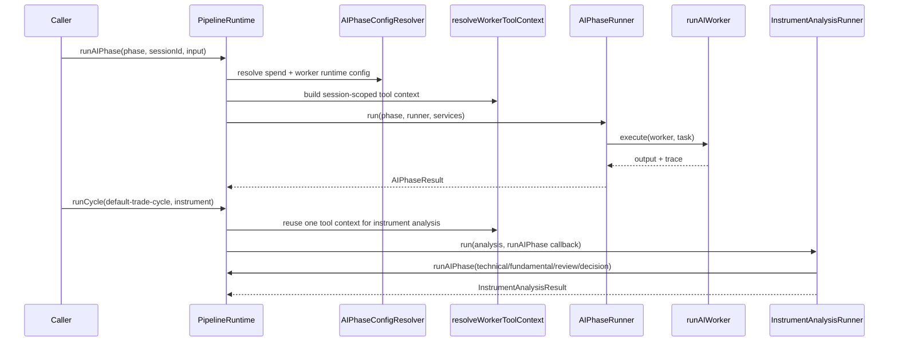

# pipeline/core

This is the front door and shared plumbing for the pipeline. It wires dependencies into phase and instrument-analysis runners, validates static definitions, and controls how worker groups are scheduled.

## How it works

- `pipeline-runtime.ts` owns the public runtime surface used by the trading orchestrator.
- `PipelineRuntime.runAIPhase()` resolves strategy context, session state, effective instrument classes, worker tool context, and spend caps before handing the phase to `AIPhaseRunner`.
- `PipelineRuntime.runCycle()` resolves the registered instrument analysis, prepares a shared tool context, and passes a callback that lets analysis steps run AI phases.
- `PipelineRuntime.runPlan()` is a compatibility dispatcher. It accepts either a phase id or an instrument-analysis id and calls the appropriate runtime method.
- `PipelineRuntime.resolveEffectiveConfig()` and `assertValidEffectiveConfig()` expose effective AI phase config checks before launch.
- `pipeline-registry.ts` validates static `PipelineDefinition` objects at module load. It catches mismatched ids, missing schemas, duplicate workers, unknown tools, unknown dependencies, and dependency cycles.
- `worker-graph-scheduler.ts` supports two scheduling modes: `flat_parallel` for all workers at once and `dependency_graph` for workers grouped by dependency frontier.
- `runWorkerBatches()` runs dependency frontiers in order and slices each frontier by max concurrency.
- `concurrent-group-runner.ts` uses `p-queue` to run async worker tasks with bounded concurrency and logs batch start/finish counts.
- `types.ts` contains the runtime-facing contracts for worker output schemas, resolved worker execution config, phase run context, and the `AIWorkerRunner` interface passed into phase implementations.
- This folder should stay framework-only. It can know about pipeline concepts and dependency injection, but trading-specific selector or trade behavior belongs under `implementations/`.

## Flow

## Terms

- **PipelineRuntime** - service object that adapts app dependencies into the reusable pipeline runners.
- **AIWorkerRunner** - small interface given to phases so they can execute one worker or a concurrent group without depending on provider registries directly.
- **WorkerExecConfig** - resolved runtime config for a worker, including retry, caps, prompt limits, tool ids, engine bindings, output schema, and terminal tool names.
- **frontier** - numeric worker-dependency level. Frontier `0` has no dependencies; frontier `1` waits for frontier `0`, and so on.
- **flat_parallel** - scheduling mode where every worker is in one frontier.
- **dependency_graph** - scheduling mode where worker `dependsOn` metadata determines frontier order.
