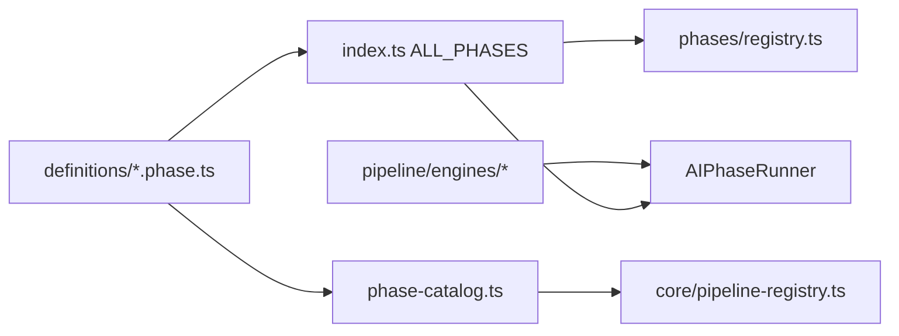

# pipeline/definitions

Executable phase configuration. Each phase is one `AIPhase` object plus optional schemas.

## How it works

- One file per phase: `selector.phase.ts`, `technical.phase.ts`, `fundamental.phase.ts`, `review.phase.ts`, `decision.phase.ts`.
- `selector.schemas.ts` holds selector worker zod schemas.
- `index.ts` is the manifest: `ALL_PHASES` + `registerAllPhases()` for boot registration.
- `phase-catalog.ts` derives static `PipelineDefinition` metadata for effective-config validation and developer tooling. Execution always uses the `AIPhase` objects.
- Phase-level business logic lives in `pipeline/engines/` and is referenced by engine ID from the phase file. Stage-local logic (e.g. `applyResults`) stays in the phase file.
- Do not put session-specific logic here. These files should remain static declarations safe to inspect without touching the database or network.

## Flow

## Terms

- **AIPhase** - executable runtime config: engine IDs, worker stages, optional `filterOutput`.
- **phase catalog** - static metadata (`outputMode`, persistence, default workers) derived from phase files for tooling.
- **PipelinePhase** - phase id: `selector`, `technical`, `fundamental`, `review`, or `decision`.
