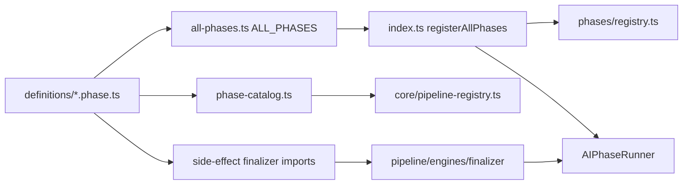

# pipeline/definitions

Executable phase configuration. Each phase is one `AIPhase` object plus optional schemas and helpers.

## How it works

- One file per phase: `selector.phase.ts`, `technical.phase.ts`, `fundamental.phase.ts`, `review.phase.ts`, `decision.phase.ts`.
- `all-phases.ts` exports `ALL_PHASES`, the canonical ordered list. It has no engine side effects — safe for catalog, tests, and iteration without triggering registration.
- `selector.schemas.ts` and `selector.helpers.ts` hold selector worker zod schemas and stage-local merge/score logic.
- `aggregator.types.ts` defines `AggregatorPlanState` (empty state object) used by trade phases.
- `index.ts` is the boot manifest: imports `engines/` as a side effect, then `registerAllPhases()` registers each phase and unified plan refs for `analysis-resolver.ts`.
- `phase-catalog.ts` derives static `PipelineDefinition` metadata for effective-config validation and developer tooling. It calls each phase's `resolveWorkersForMode()` — the same function runtime stages use — so catalog and execution always agree on workers.
- Each phase declares `resolveWorkersForMode(discoveryMode)` for worker sets that vary by `trend_scan` vs `event_contract_scan`. Review and decision worker sets are mode-invariant today.
- Phase-level business logic lives in `pipeline/engines/` and is referenced by engine ID from the phase file. Stage-local logic (e.g. selector `applyResults()`) stays in the phase file or co-located helpers.
- Trade-phase finalizer engines self-register via side-effect imports in each `*.phase.ts`. Selector shared engines register centrally in `engines/index.ts`.
- Do not put session-specific logic here. These files should remain static declarations safe to inspect without touching the database or network.

## Adding a new phase

1. Create `definitions/[name].phase.ts` with an `AIPhase` that includes `catalog`, `resolveWorkersForMode`, worker stages, and `finalizeEngineIds`.
2. Create `engines/finalizer/[name]-aggregator.ts` and side-effect import it from the phase file.
3. Add the phase to `ALL_PHASES` in `all-phases.ts`.
4. No changes needed in `phase-catalog.ts` — it derives metadata from `ALL_PHASES` automatically.

## Flow

## Terms

- **AIPhase** - executable runtime config: engine IDs, worker stages, `resolveWorkersForMode`, optional `filterOutput`, `summarize`, `persistAggregate`.
- **ALL_PHASES** - canonical list of five registered phases in execution order.
- **phase catalog** - static metadata (`outputMode`, persistence, default workers) derived from phase files for tooling.
- **PipelinePhase** - phase id: `selector`, `technical`, `fundamental`, `review`, or `decision`.
- **ResearchDiscoveryMode** - session strategy field that selects worker sets via `resolveWorkersForMode`.
