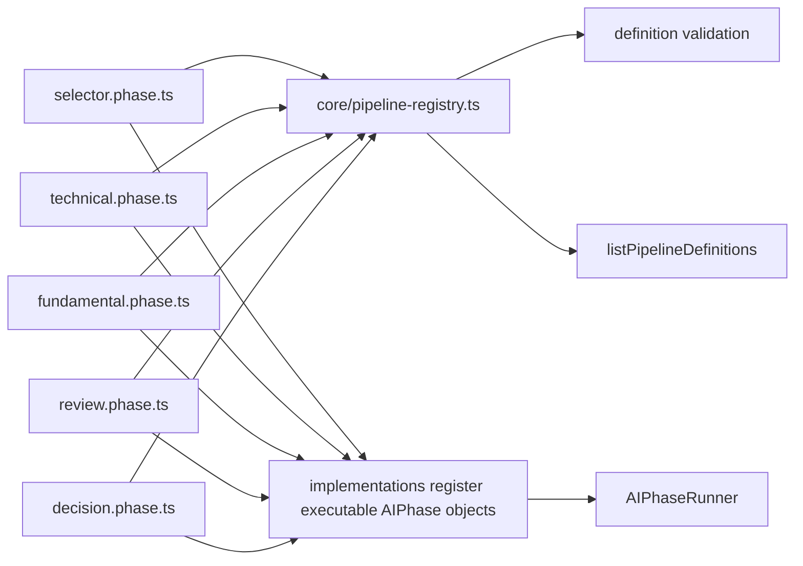

# pipeline/definitions

Describes the static shape of each AI phase. These files say what workers exist, what tools and schemas they use, and how their output should be persisted, but they do not run the workers themselves.

## How it works

- One file maps to one `PipelinePhase`: `selector.phase.ts`, `technical.phase.ts`, `fundamental.phase.ts`, `review.phase.ts`, and `decision.phase.ts`.
- Each exported constant is a `PipelineDefinition<TInput, TOutput>` from `@electron/shared/ai/ai-phase`.
- A definition includes the phase id, output mode, output schema when object output is expected, worker definitions, optional deterministic engine bindings, and persistence metadata.
- `selector.phase.ts` points at discovery workers chosen by `selectorDiscoveryWorkersForMode("trend_scan")` and declares terminal-tool output for `InstrumentSelection`.
- `technical.phase.ts` and `fundamental.phase.ts` use mode-aware worker lists and bind their finalize aggregators.
- `review.phase.ts` defines two fixed reviewer workers: `conflict-detector` and `risk-assessor`.
- `decision.phase.ts` defines two fixed decision workers: `signal-classifier` and `entry-timer`.
- `core/pipeline-registry.ts` imports these definitions and validates them at startup, including duplicate worker ids, missing schemas, unsupported tool ids, and invalid worker dependencies.
- The richer executable `AIPhase` objects live in `implementations/selector` and `implementations/trade`. Those implementations use this metadata but add entry modes, input builders, batch behavior, finalization, cache policy, and output filtering.
- Do not put session-specific logic here. These files should remain static declarations that are safe to inspect and validate without touching the database or network.

## Flow

## Terms

- **PipelineDefinition** - static description of a phase's workers, output mode, output schema, engine bindings, and persistence metadata.
- **PipelinePhase** - named phase id shared across config, prompts, traces, and runtime code: `selector`, `technical`, `fundamental`, `review`, or `decision`.
- **output mode** - how a worker or phase returns its result, such as object output or a terminal submit-output tool.
- **persistence metadata** - schema name and trace mode used when the runtime stores aggregate AI output in agent run/message tables.
