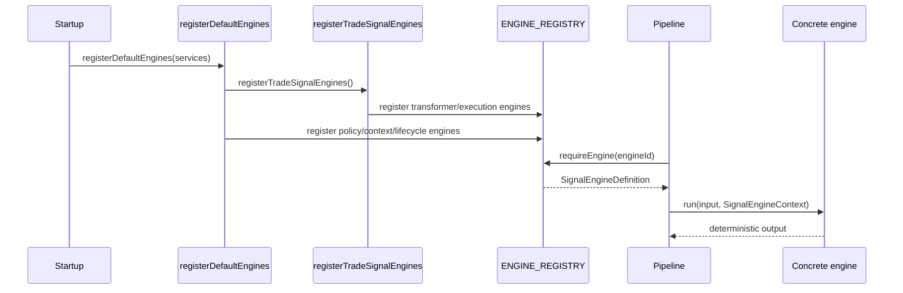

# pipeline/engines/signal-registry

The registry lets pipeline code refer to deterministic signal work by id instead of importing concrete functions. Startup registers the built-in engines once; instrument-analysis engine steps and worker-level `ENGINE_BINDINGS` look up engines such as `candidate-validator`, `risk-gate`, or `trade-execution-profile` by name.

Phase finalizer engines in `pipeline/engines/finalizer/` are a separate layer. They wrap aggregators/scoring functions from this folder for the definition-first `AIPhaseRunner` path. Both registries coexist: signal registry for direct engine dispatch, phase engine registry for orchestration hooks on `AIPhase`.

## How it works

- `types.ts` defines `SignalEngineContext` and `SignalEngineDefinition`. A definition has an `id`, `kind`, input schema, output schema, and `run(input, ctx)` function.
- `SignalEngineContext` carries session id, phase, cycle id, strategy context, and optional service dependencies for risk, candidate validation, order policy, broker allocation, and exit policy.
- `signal-engine-registry.ts` stores engines in an in-memory `Map<EngineId, AnySignalEngine>`. `registerSignalEngine` writes definitions, `getSignalEngine` returns optional definitions, and `requireEngine` throws if an expected engine was not registered.
- `register-trade-signal-engines.ts` registers deterministic transformer/execution engines for selector candidate merge, selector scoring, selector submission building, technical/fundamental/review/trade aggregation, and trade execution profile calculation.
- `register-default-engines.ts` calls `registerTradeSignalEngines()` and then registers policy/context/lifecycle engines backed by injected services: risk summary, candidate validator, order policy, broker allocation, exit policy, and risk gate.
- Several current engine definitions use `z.any()` for schemas and cast inputs internally. That makes registration flexible but puts more responsibility on pipeline callers and tests to pass the expected shape.
- Registration is process-local. There is no persistence layer here; engines must be registered during service startup before pipeline definitions try to require them.
- This folder should not contain the business logic of an engine. It should register functions from `aggregators/`, `scoring/`, `execution/`, or injected services and provide the lookup boundary.

## Flow

## Terms

- **SignalEngineDefinition** - Registered engine record containing id, kind, schemas, and run function.
- **SignalEngineContext** - Runtime context passed to engines, including session/phase/cycle identifiers, strategy context, and optional service dependencies.
- **EngineId** - Shared identifier used by pipeline definitions to look up an engine.
- **EngineKind** - Category for an engine, such as transformer, execution, policy, context, validator, or lifecycle.
- **Default engines** - Built-ins registered during startup by `registerDefaultEngines`.
- **Process-local registry** - In-memory map that exists only for the running Electron main process.
