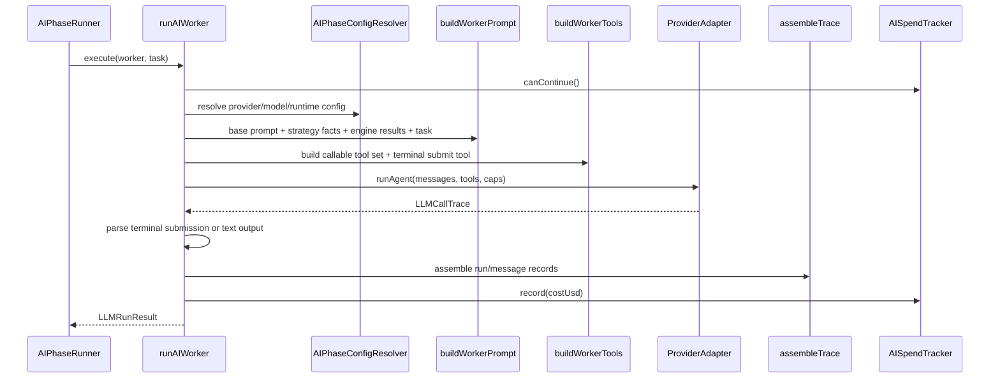

# pipeline/execution

Runs the low-level execution work inside the pipeline. This folder is where one worker becomes one provider call, one deterministic engine step becomes one state patch, and every run gets validated, traced, and charged against spend caps.

## How it works

- `worker-executor.ts` exports `runAIWorker()`, the end-to-end AI worker call path.
- A worker run resolves provider/model/runtime config through `AIPhaseConfigResolver`, chooses default or session-override prompt markdown, injects read-mode engine context, builds prompt messages, builds callable tools, and invokes the configured provider adapter through `withLLMRetry()`.
- Terminal-tool workers validate their final submission with `parseWorkerOutput()`. If validation requests a retry, the worker gets one more provider call before failing or substituting the configured fallback.
- `worker-tool-requirements.ts` checks whether required tools were actually used by the model and summarizes coverage for logs and selector diagnostics.
- `trace-assembler.ts` converts raw LLM traces into `AgentRun` and `AgentMessage` records. It also builds aggregate phase traces from multiple worker traces.
- `ai-spend-tracker.ts` tracks phase, pipeline, and session spend. Live sessions stop launching more workers when a cap is exceeded; paper/mock sessions can warn only through sandbox budgeting.
- `engine-prompt-injector.ts` runs read-mode signal engines before a worker call and injects the result into the prompt payload.
- `input-builder-registry.ts` registers deterministic signal-engine input builders used by instrument-analysis engine steps.
- `stage-dispatch.ts` runs one deterministic engine or a chain of engines and applies state patches from the selected input builder.
- `worker-structured-output.ts` and its tests cover strict schema validation for worker terminal output.
- `tool-use-harness.ts` is a thin provider test harness for tool-call experiments and schema-backed provider invocation.
- This folder should not decide which phase or trade-analysis steps exist. It only executes the work requested by `phases/` and `analysis/`.

## Flow

## Terms

- **AI worker** - one model-backed worker invocation for a phase.
- **terminal tool** - schema-backed submit-output tool that a worker must call to provide structured output.
- **LLMCallTrace** - raw provider trace containing messages, tool steps, token usage, cost, finish reason, and assistant text.
- **AgentRun** - persisted run summary used by the UI and audit trail.
- **AgentMessage** - persisted message and trace payload for a run, including prompt messages, tool calls, output JSON, and strategy snapshot.
- **read-mode engine** - deterministic signal engine that runs before a worker and contributes structured context to the prompt.
- **engine step** - deterministic post-AI analysis step that consumes state and writes a state patch or rejection.
- **spend cap** - configured phase, pipeline, or session budget checked before and after worker calls.
