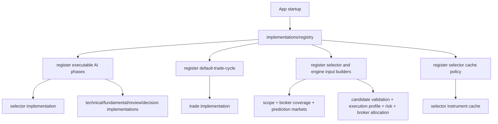

# pipeline/implementations

Contains the parts of the pipeline that are specific to Exva trading. The reusable framework can run phases and analyses, but this folder tells it how Exva discovers instruments, analyzes trades, builds deterministic inputs, caches selector output, and registers the default analysis set.

## How it works

- `selector/` implements the selector phase. It turns session scope and broker coverage into discovery instructions, asks discovery workers for candidates, verifies the strongest candidates, scores them, filters them, and returns an `InstrumentSelection`.
- `trade/` implements the production `default-trade-cycle` instrument analysis. It runs candidate validation, technical, fundamental, review, decision, and final deterministic gates for one selected instrument.
- `inputs/` contains deterministic input builders used before selector workers and before post-AI signal engines.
- `cache/` contains selector cache policy and fingerprint logic so stale instrument selections are not reused after relevant configuration changes.
- `registry/` wires the implementation layer into generic registries at startup.
- The framework folders (`core/`, `phases/`, `analysis/`, `execution/`, `prompting/`, `worker-tools/`) should not know the details in this folder.
- New trading-specific phases, analysis ids, cache policies, or input builders should be registered here rather than from the generic runtime.
- Current code still has some compatibility names like `plan`, `cycle`, and `stage` in function names and logs. In docs, prefer the clearer domain terms: AI phase, instrument analysis, worker batch, analysis step, and trading-loop tick.

## Flow

## Terms

- **implementation** - trading-specific executable definition plugged into the generic pipeline framework.
- **selector analysis** - phase that finds instruments worth a full trade analysis.
- **trade analysis** - ordered analysis for one selected instrument.
- **input builder** - deterministic builder that produces prompt instructions or signal-engine task payloads from session/runtime state.
- **registry** - startup lookup table that lets the runtime resolve phases, analyses, cache policies, and input builders by id.
