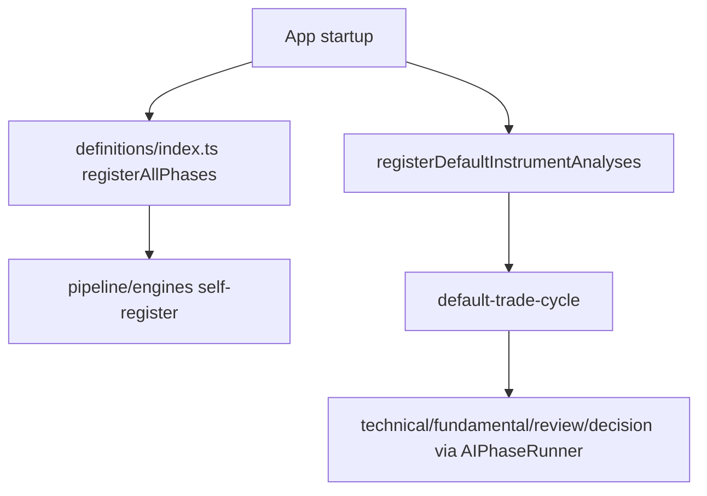

# pipeline/implementations

Trading-specific instrument analysis wiring. Phase definitions moved to `definitions/`; phase engines moved to `engines/`.

## How it works

- `trade/` implements the production `default-trade-cycle` instrument analysis: candidate validation, technical, fundamental, review, decision, and deterministic post-decision gates for one selected instrument.
- `inputs/` contains deterministic input builders for post-AI signal engines (trade cycle only).
- `registry/` wires instrument analyses into runtime lookup tables at startup via `register-analyses.ts` and `analysis-resolver.ts`.
- Phase boot registration lives in `definitions/index.ts`, not here.
- The framework folders (`core/`, `phases/`, `analysis/`, `execution/`, `prompting/`, `worker-tools/`, `engines/`, `definitions/`) should not contain trading-specific business logic beyond what they orchestrate.

## Flow

## Terms

- **instrument analysis** - ordered analysis for one selected instrument (`default-trade-cycle`).
- **signal-engine input builder** - deterministic builder that produces engine task payloads from session/runtime state.
