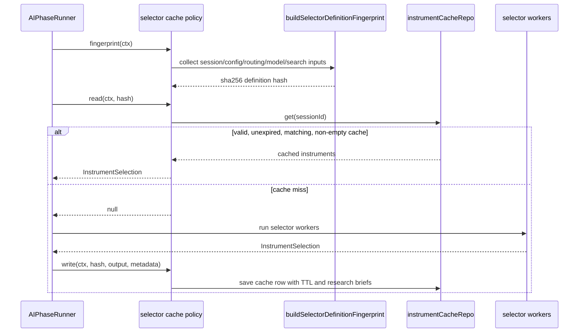

# pipeline/implementations/cache

Keeps selector result caching honest. This folder decides when a previous instrument selection can be reused and when configuration, routing, model, prompt, search, or time changes make it unsafe.

## How it works

- `selector-instrument-cache.ts` exports `SELECTOR_INSTRUMENT_CACHE_POLICY`, the cache policy registered under id `selector-instrument-cache`.
- The cache stores selector output in `instrumentCacheRepo`, not in memory, so session runs can reuse recent results across runtime calls.
- `buildSelectorDefinitionFingerprint()` captures every input that should make cached selector output invalid.
- The fingerprint includes selection mode, AI picker enabled state, instrument scope, effective instrument classes, search provider id, selector role provider/model/prompt source/prompt markdown, and broker routing snapshot.
- Effective instrument classes are resolved with `resolveSessionInstrumentClasses()`, so search-everything sessions are fingerprinted against broker-backed classes rather than stale manual class picks.
- Broker routing snapshot records one resolved broker account id per instrument class, or `null` when routing cannot resolve a broker.
- The fingerprint is stable-stringified and SHA-256 hashed before comparison.
- Cache reads fail closed. Missing cache, expired cache, mismatched definition hash, invalid JSON, and empty instrument arrays all return `null`.
- Cache writes store selected instruments, definition hash, selector agent run id, cycle id, research brief summaries, generation timestamp, and an expiration timestamp.
- Cache TTL depends on strategy holding style: intraday is 30 minutes, multi-day swing is 4 hours, weeks-position is 24 hours, and unknown styles default to 4 hours.

## Flow

## Terms

- **Cache policy** - rules for reading, invalidating, and writing cached selector results.
- **definition fingerprint** - stable hash of selector inputs that affect whether cached output is still valid.
- **routing snapshot** - broker account resolution by instrument class at the time the selector cache key is built.
- **TTL** - time-to-live for cached instruments before they are treated as expired.
- **research briefs** - compact selector evidence summaries saved alongside cached instruments for downstream context and debugging.
