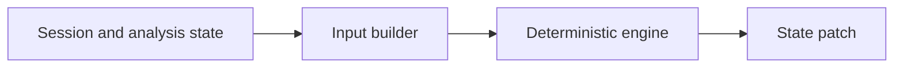

# pipeline/implementations/inputs

Builds the deterministic inputs needed by non-AI trade-analysis steps. These builders take session state, instrument metadata, quotes, and prior phase output and shape them into the exact payload each signal engine expects.

## Technical

- `trade-engine-input-builders.ts` contains the candidate-validation, execution-profile, risk-gate, and broker-allocation builders.
- Other files prepare selector and scope inputs before the AI selector phase runs.
- Builders can also patch analysis state after an engine succeeds.

## Flow

## Terms

- **Input builder** — deterministic code that translates runtime state into an engine-specific task payload.
