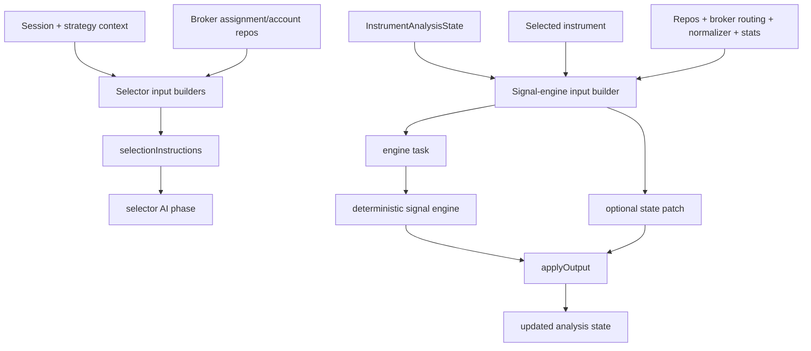

# pipeline/implementations/inputs

Builds deterministic input text and engine payloads for the trading pipeline. These builders translate session state, strategy settings, broker coverage, selected instruments, quotes, and prior phase output into the exact instructions or task objects needed by selector workers and signal engines.

## How it works

- `selector-scope.ts` builds selector instructions from the session's instrument scope. The special search-everything scope tells the selector to search across broker-backed instrument classes, verify tradability, and avoid memory-only ticker recall.
- `broker-coverage.ts` adds explicit broker coverage constraints to selector instructions, including assigned brokers and which instrument classes each can trade.
- `prediction-market-candidates.ts` fetches canonical prediction-market candidates when the effective instrument classes include `prediction_market`; it returns `null` when that class is not enabled or no candidates exist.
- `manual-shortlist.ts` parses manual instrument scope lines into an `InstrumentSelection` when the session is in manual shortlist mode or AI picking is disabled.
- `trade-engine-input-builders.ts` registers four signal-engine input builders used by the default trade analysis.
- `candidate-validation` resolves the broker adapter, normalizes the symbol to broker format, fetches a market snapshot, and patches `quoteSnapshot` into analysis state.
- `execution-profile` requires decision and review output and builds the task used to compute position size, side, entry, stop, and target profile.
- `risk-gate` requires the execution profile and decision output, loads dashboard stats, and builds the proposed order payload for risk policy evaluation.
- `broker-allocation` requires a risk-approved order, resolves the broker account for the instrument class, and verifies allocation/conflict rules.
- Engine input builders can return a `statePatch` before engine output is applied, and can implement `applyOutput()` to write engine results back into `InstrumentAnalysisState` or reject the trade.

## Flow

## Terms

- **selector input builder** - builder that returns a text section appended to selector `selectionInstructions`.
- **signal-engine input builder** - builder that returns a typed task for one deterministic signal engine.
- **statePatch** - partial `InstrumentAnalysisState` applied before an engine output is interpreted.
- **applyOutput** - builder hook that converts engine output into new analysis state or throws an app error to reject the candidate/trade.
- **manual shortlist** - session mode where user-provided symbols bypass AI discovery and become selector output directly.
