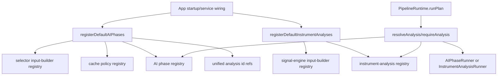

# pipeline/implementations/registry

Wires Exva's trading pipeline into runtime lookup tables. If a selector phase, trade analysis, input builder, or cache policy should exist when the app starts, this folder registers it.

## How it works

- `register-phases.ts` registers selector input builders, the selector cache policy, the executable selector phase, and the executable trade-analysis AI phases (`technical`, `fundamental`, `review`, `decision`).
- `register-analyses.ts` registers deterministic signal-engine input builders and the `default-trade-cycle` instrument analysis.
- `analysis-resolver.ts` resolves an id to either a phase definition or an instrument analysis. `PipelineRuntime.runPlan()` uses this to support both direct phase runs and full instrument analysis runs.
- `analysis-kinds.ts` defines the union types used by the resolver and dispatcher.
- `analysis-dispatcher.ts` is a small adapter that can run either an `AIPhaseRunner` or `InstrumentAnalysisRunner` based on resolved kind.
- `input-builder-registry.ts` registers selector input builders and builds composite selector instruction text in declaration order.
- `cache-policy-registry.ts` stores cache policies by id and throws loudly if a phase references an unregistered policy.
- Registration is explicit and local. Adding a new implementation should include a registration path here; relying on import side effects elsewhere makes the runtime hard to reason about.
- Resolver and inspect helpers are used by effective configuration code and developer tooling to list available analysis ids and derive stage/engine metadata.

## Flow

## Terms

- **registry** - lookup table the runtime uses to resolve phases, analyses, cache policies, or builders by id.
- **unified analysis id** - id accepted by the compatibility resolver, whether it points to a single phase or a full instrument analysis.
- **phase registration** - adding an executable `AIPhase` to the phase registry.
- **instrument-analysis registration** - adding a full ordered analysis like `default-trade-cycle` to the analysis registry.
- **composite input** - selector instruction text built by concatenating registered input-builder output sections.
