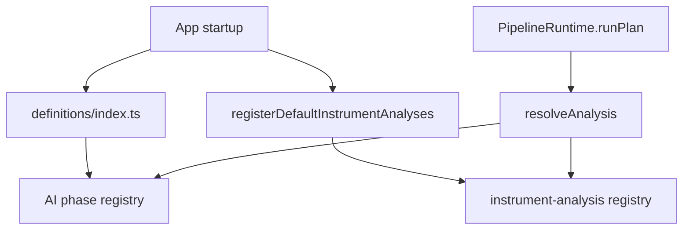

# pipeline/implementations/registry

Resolves plan ids to either an executable AI phase or a full instrument analysis.

## How it works

- `register-analyses.ts` registers deterministic signal-engine input builders and the `default-trade-cycle` instrument analysis.
- `analysis-resolver.ts` resolves an id to either a phase definition or an instrument analysis. `PipelineRuntime.runPlan()` uses this for direct phase runs and full analysis runs.
- `analysis-kinds.ts` defines union types used by the resolver and dispatcher.
- `analysis-dispatcher.ts` runs either `AIPhaseRunner` or `InstrumentAnalysisRunner` based on resolved kind.
- Phase registration moved to `definitions/index.ts`. Phase engines self-register from `engines/index.ts`.

## Flow

## Terms

- **unified analysis id** - id accepted by the compatibility resolver, whether it points to a single phase or a full instrument analysis.
- **phase-engine registry** - lookup table in `pipeline/engines/registry.ts` used by `AIPhaseRunner` to resolve phase-level hooks by ID and kind.
