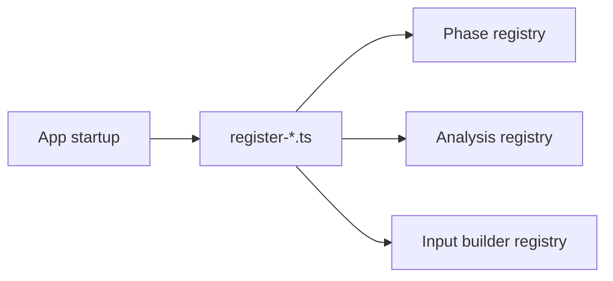

# pipeline/implementations/registry

Wires the trading-specific pipeline pieces together at startup. If a selector analysis, trade analysis, or input builder should exist in the app, it gets registered from here.

## Technical

- `register-analyses.ts` registers the default trade analysis and its deterministic input builders.
- `register-phases.ts` registers the default phase definitions.
- `analysis-dispatcher.ts`, `analysis-resolver.ts`, and `analysis-kinds.ts` support lookup and dispatch by plan id.
- `cache-policy-registry.ts` and `input-builder-registry.ts` hold auxiliary registries used during execution.

## Flow

## Terms

- **Registry** — lookup table the runtime uses to resolve plans or builders by id.
