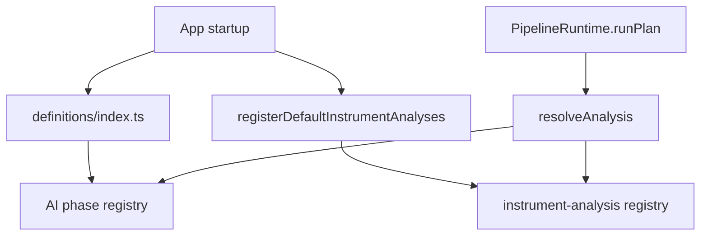

# pipeline/implementations/registry

Resolves plan ids to either an executable AI phase or a full instrument analysis.

## How it works

- `register-analyses.ts` registers deterministic signal-engine input builders and the `default-trade-cycle` instrument analysis.
- `analysis-resolver.ts` resolves an id to either a phase definition or an instrument analysis. Phase IDs are registered as unified plan refs by `definitions/index.ts` so `runPlan("selector")` and `runPlan("default-trade-cycle")` share one lookup. `PipelineRuntime.runPlan()` uses this resolver to call either `AIPhaseRunner` or `InstrumentAnalysisRunner` directly.
- `analysis-kinds.ts` defines union types used by the resolver.
- Phase registration lives in `definitions/index.ts` (`registerAllPhases()`). Phase engines register from `engines/index.ts` and side-effect imports in phase definition files.

## Flow

## Terms

- **unified plan ref** - phase id registered alongside instrument analyses so `analysis-resolver.ts` can look up either kind by string id.
- **phase-engine registry** - lookup table in `pipeline/engines/registry.ts` used by `AIPhaseRunner` to resolve phase-level hooks by ID and kind.
