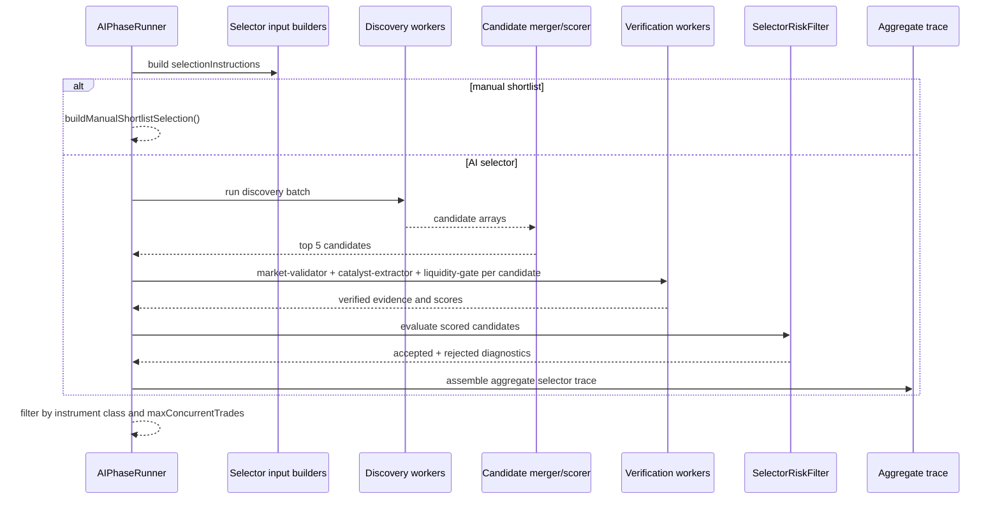

# pipeline/implementations/selector

Finds the instruments Exva should analyze next. It starts broad, asks discovery workers for candidates, verifies the best ones with market/news evidence, then returns a ranked selection capped by the session's risk settings.

## How it works

- `selector-analysis.ts` exports `SELECTOR_PLAN`, the executable `AIPhase<SelectorPlanState, InstrumentSelection>` for the `selector` phase.
- `selector-schemas.ts` defines the Zod output schemas for discovery candidates and verification results.
- The phase uses cache policy id `selector-instrument-cache` and input builders `selector-scope`, `broker-coverage`, and `prediction-market-candidates`.
- Manual selector mode short-circuits worker execution through an entry mode. It parses the session's manual shortlist and returns those instruments directly.
- AI selector mode requires non-empty `selectionInstructions`; these instructions are assembled by selector input builders before workers run.
- The `discovery` worker batch resolves workers from `selectorDiscoveryWorkersForMode(ctx.strategyContext.researchPosture.discoveryMode)`, runs up to three in parallel, tolerates partial failure, and requires at least one successful worker.
- Discovery output is merged by `mergeDiscoveryCandidates()`, scored by `scoreCandidate()`, and trimmed to the top five candidates for verification.
- The `verification` worker batch creates three workers per candidate: `market-validator`, `catalyst-extractor`, and `liquidity-gate`.
- Verification workers use market tools and search/news/fetch tools to fill in evidence, liquidity, catalyst, volume, rationale, and risk flags.
- Finalization attaches `SelectorEvidence`, runs `SelectorRiskFilter`, builds the final `InstrumentSelection`, and stores diagnostics including discovered count, verified count, accepted count, rejected candidates, and worker tool coverage.
- The aggregate selector trace records worker outputs and diagnostics so the developer UI can explain why candidates were accepted or rejected.
- `filterOutput()` removes any instrument outside the effective instrument class set and enforces `maxConcurrentTrades`.

## Flow

## Terms

- **Selector candidate** - proposed instrument being evaluated for promotion into the trade-analysis path.
- **discovery worker** - worker that searches broadly and proposes candidate instruments.
- **verification worker** - worker that checks one candidate with market, liquidity, catalyst, news, or search evidence.
- **SelectorEvidence** - normalized evidence summary passed from selector output into downstream technical/fundamental phases.
- **SelectorRiskFilter** - deterministic filter that rejects candidates outside session instrument classes, broker coverage, or risk constraints.
- **InstrumentSelection** - final selector output consumed by the trading orchestrator.
