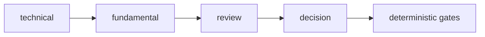

# pipeline/implementations/trade

Defines the default full trade analysis for one instrument. This is the concrete sequence Exva runs after the selector chooses something worth studying.

## Technical

- `default-analysis.ts` exports the `default-trade-cycle` `InstrumentAnalysis`.
- `default-analysis-steps.ts` builds the ordered stage list.
- `phase-analyses.ts` and `aggregator-phase-plan.ts` hold reusable stage helpers for the trade flow.

## Flow

## Terms

- **InstrumentAnalysis** — ordered sequence of AI phases and deterministic steps for one instrument.
