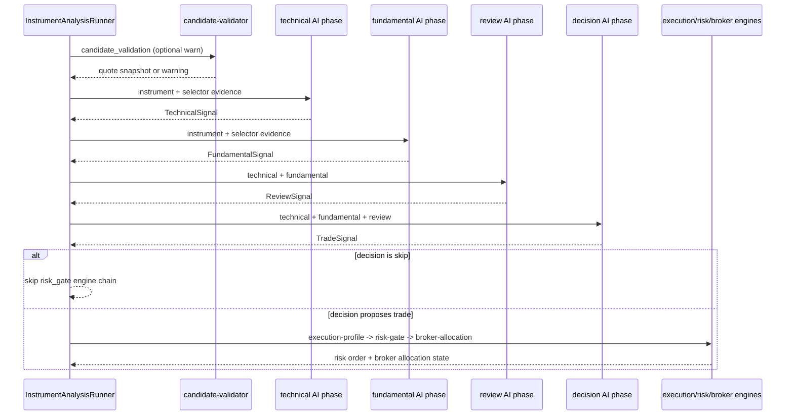

# pipeline/implementations/trade

Defines the default trade analysis for one selected instrument. After the selector picks a symbol, this is the sequence Exva runs to decide whether to trade it and whether the proposed order is allowed.

## How it works

- `default-analysis.ts` exports `DEFAULT_TRADE_CYCLE`, the production `InstrumentAnalysis` with id `default-trade-cycle`.
- `default-analysis-steps.ts` defines the ordered analysis steps and maps each one to an execution-stage id for progress/retry orchestration.
- The first step, `candidate_validation`, is an optional deterministic engine that checks tradability, selected class support, selector trace, quote snapshot, side bias, and timeframe context.
- The `technical` and `fundamental` AI phases run independently in sequence and each produces a typed signal.
- The `review` AI phase consumes both technical and fundamental signals and produces conflict/risk review output.
- The `decision` AI phase consumes technical, fundamental, and review output and produces the final trade signal.
- The `risk_gate` engine chain is skipped when the decision action is `skip`. Otherwise it runs `trade-execution-profile`, `risk-gate`, and `broker-allocation` in order.
- `tradeCycleStageFailurePolicy()` exposes the declared failure policy for orchestration code.
- `tradeCycleInspectMetadata()` produces inspect metadata used by config and developer tooling.
- `phase-analyses.ts` still registers executable AI phases for `technical`, `fundamental`, `review`, and `decision` until Phases 3-4 move them into `definitions/`.
- `aggregator-phase-plan.ts` still contains `createAggregatorAIPhase()`, a helper for phases that run parallel workers and then use one aggregator call to produce the final phase signal. It now emits the Phase 1 engine-ID fields, but still relies on the temporary legacy `finalize?` fallback until finalizer engines are added.
- Aggregate traces for trade phases are returned to the instrument analysis, but `persistAggregate: false` prevents duplicate persistence because trade insertion owns the final audit path.

## Flow

## Terms

- **InstrumentAnalysis** - ordered sequence of AI phases and deterministic engine steps for one instrument.
- **default-trade-cycle** - current production analysis id for full trade evaluation.
- **candidate validation** - pre-AI deterministic check that verifies the selected instrument is tradable enough to analyze.
- **aggregator phase** - phase pattern where multiple workers run, their outputs are collected, and a deterministic aggregator engine creates one typed signal.
- **risk gate** - final deterministic engine chain that builds order shape, checks risk policy, and resolves broker allocation before any order can proceed.
