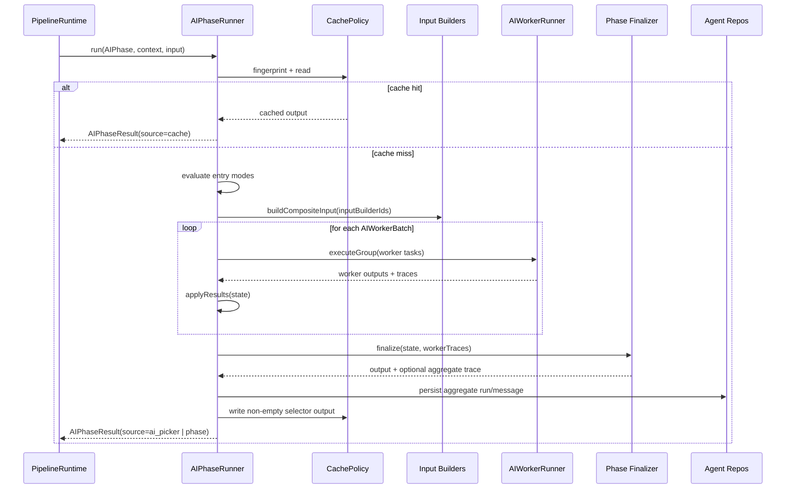

# pipeline/phases

Runs one AI phase from start to finish. A phase is the unit that fans out workers, collects their outputs, finalizes them into one typed result, and optionally reads or writes a selector cache entry.

## How it works

- `interpreter.ts` exports `AIPhaseRunner`, the runner for executable `AIPhase` objects.
- `types.ts` defines the phase contracts: `AIPhase`, `AIWorkerBatch`, `AIPhaseEntryMode`, `AIWorkerTrace`, `AIPhaseContext`, and `AIPhaseResult`.
- `registry.ts` stores executable phases registered by `implementations/registry/register-phases.ts`.
- `services.ts` lists the repositories and services a phase can use, such as selector settings, AI phase config, instrument cache, agent run/message repos, broker routing, and strategy context.
- A phase starts by building an `AIPhaseContext` from session data, strategy context, tool context, runtime services, and caller input.
- If `cachePolicyId` is present, the runner computes a fingerprint and returns cached output before any workers run.
- Entry modes can short-circuit worker execution. The current selector uses `manual_shortlist` to return manual instruments when AI picking is disabled.
- `inputBuilderIds` append deterministic text sections to phase input before workers run. The selector uses this for scope, broker coverage, and prediction-market candidates.
- Worker batches run in order. Each batch resolves workers, builds a task payload, calls the injected `AIWorkerRunner`, enforces partial-failure rules, records worker traces, and updates phase state.
- `finalize()` turns accumulated batch state into one typed output and can produce an aggregate trace for persistence.
- Cache writes happen only when the phase has a cache policy, aggregate trace metadata exists, and the output is non-empty.
- `filterOutput()` is the final phase-level safety hook; the selector uses it to remove instruments outside the effective class set and cap results by max concurrent trades.

## Flow

## Terms

- **AIPhase** - executable definition of one phase, including entry modes, worker batches, finalizer, cache metadata, and inspect metadata.
- **AIWorkerBatch** - group of workers run together with one concurrency setting and one result-application function.
- **entry mode** - shortcut path that can return output without worker execution, such as manual selector mode.
- **cache policy** - read/write policy that decides whether a previous phase output can be reused.
- **AIWorkerTrace** - per-worker trace metadata used to build an aggregate phase trace.
- **source** - `AIPhaseResult.source`, describing where output came from: cache, manual shortlist, AI picker, or a direct phase run.
