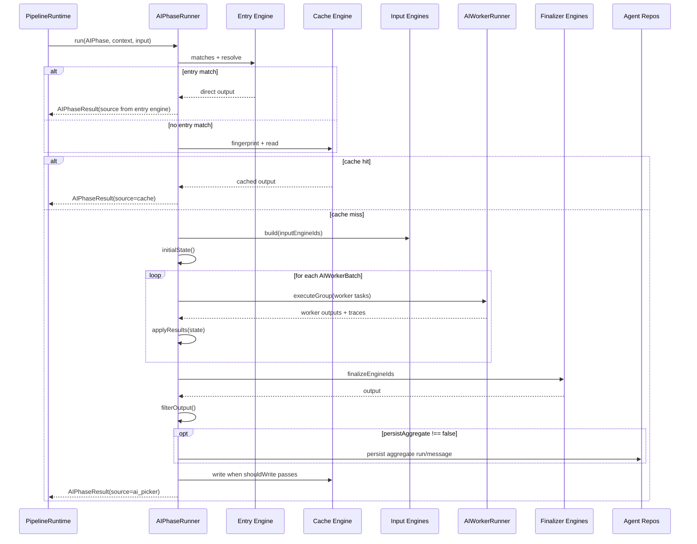

# pipeline/phases

Runs one AI phase from start to finish. A phase is the unit that checks entry-mode engines, reads cache, builds deterministic input context, fans out workers, collects their outputs, finalizes them into one typed result, filters output, assembles aggregate traces, and optionally writes a cache entry.

## How it works

- `interpreter.ts` exports `AIPhaseRunner`, the generic runner for executable `AIPhase` objects. It contains no phase-specific logic.
- `types.ts` defines the phase contracts: `AIPhase`, `AIWorkerBatch`, `AIWorkerTrace`, `AIPhaseContext`, `AIPhaseResult`, and `AIPhaseSource`.
- `registry.ts` stores executable phases registered at boot by `definitions/index.ts` via `registerAIPhase()`.
- `services.ts` lists the repositories and services a phase can use, such as selector settings, AI phase config, instrument cache, agent run/message repos, broker routing, and strategy context.
- A phase starts by building an `AIPhaseContext` from session data, strategy context, tool context, runtime services, and caller input.
- `entryEngineIds` are checked first. A matching entry engine short-circuits cache, input building, workers, finalizers, and cache write. Selector registers `manual-shortlist` (`source: "manual_shortlist"`).
- If `cacheEngineId` is present, the runner computes a fingerprint and returns cached output before input engines or workers run.
- `inputEngineIds` append deterministic text sections to `ctx.input[inputKey]` before workers run. Selector input engines live under `pipeline/engines/input/`.
- Worker batches run in stage order. Each batch resolves workers (often via `resolveWorkersForMode(discoveryMode)`), builds a task payload, calls the injected `AIWorkerRunner`, enforces partial-failure rules, records worker traces, and updates phase state through `applyResults()`.
- `finalizeEngineIds` run after worker stages. Finalizers receive `workerResults` and run sequentially; the last return value is the phase output.
- Aggregate traces are assembled from worker traces. Phases with `persistAggregate: false` (trade phases) return trace metadata without writing to agent repos; trade insertion owns persistence.
- Cache writes happen when the phase has a cache engine, aggregate trace metadata exists (when applicable), and the cache engine's `shouldWrite()` guard passes.
- `filterOutput()` is the final phase-level safety hook; selector uses it to cap by instrument class and max concurrent trades.
- Phase definitions read metadata such as `outputSchemaName`, `summarize`, and entry `source` from the `AIPhase` object — not from interpreter if-chains.

## Flow

## Terms

- **AIPhase** - executable definition of one phase in `definitions/*.phase.ts`: engine IDs, worker batches, optional hooks, and output filter.
- **AIWorkerBatch** - group of workers run together with one concurrency setting, partial-failure policy, and one `applyResults()` function.
- **entry engine** - shortcut path that can return output without cache or worker execution, such as manual selector mode.
- **cache engine** - read/write policy that decides whether a previous phase output can be reused.
- **finalizer engine** - post-worker hook that aggregates worker outputs into the typed phase result.
- **AIWorkerTrace** - per-worker trace metadata used to build an aggregate phase trace.
- **source** - `AIPhaseResult.source`: `cache`, `manual_shortlist`, `ai_picker`, or `phase`.
