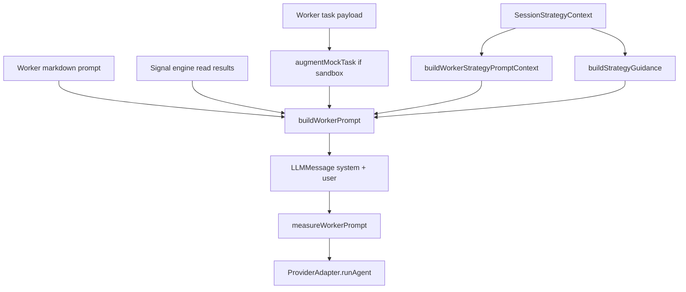

# pipeline/prompting

Builds the messages sent to each AI worker. It turns the worker's markdown prompt, trusted session strategy facts, preset guidance, deterministic engine context, and the task payload into the exact system/user messages passed to the provider adapter.

## How it works

- `worker-prompt-builder.ts` exports `buildWorkerPrompt()`, which returns a two-message `LLMMessage[]`: one system message and one user message.
- The system message starts with the worker's base prompt markdown. In paper/mock sessions it appends a sandbox block that tells the model synthetic data is authoritative and should be evaluated seriously.
- The user message contains structured XML-like blocks: `trusted_strategy_facts`, optional `trusted_strategy_guidance`, optional `session_worker_guidance`, optional `engine_results`, and `task`.
- `buildWorkerStrategyPromptContext()` includes only the fields requested by the worker's `strategyContext` metadata. This keeps prompts smaller and prevents unrelated strategy details from leaking into roles that do not need them.
- `buildStrategyGuidance()` resolves built-in preset guidance from the active research posture, trade rules, risk preset, timeframe preset, or exact global preset match.
- Worker guidance markdown is truncated to `WORKER_GUIDANCE_MARKDOWN_MAX_CHARS` so session-level free text cannot silently dominate the prompt.
- `measureWorkerPrompt()` compares final system/user character counts against `RUNTIME_DEFAULTS.prompt`. It logs warning metadata but never mutates or truncates the generated provider messages.
- `strategy-prompt-context.ts` also builds the full strategy snapshot used in persisted agent message audit records.
- Mock task augmentation happens here because the prompt builder owns the final task text the model sees. The selector receives mock-search cautions; the decision phase can receive clean-breakout entry timing guidance.

## Flow

## Terms

- **trusted strategy facts** - compact structured session settings that the worker should treat as authoritative.
- **preset guidance** - human-readable instructions derived from selected built-in strategy presets and scoped to the current phase.
- **session worker guidance** - user-authored free-text worker guidance, truncated before injection.
- **engine results** - deterministic signal-engine output added to the worker prompt before the model runs.
- **strategy snapshot** - persisted audit copy of the full effective strategy context used for a run.
