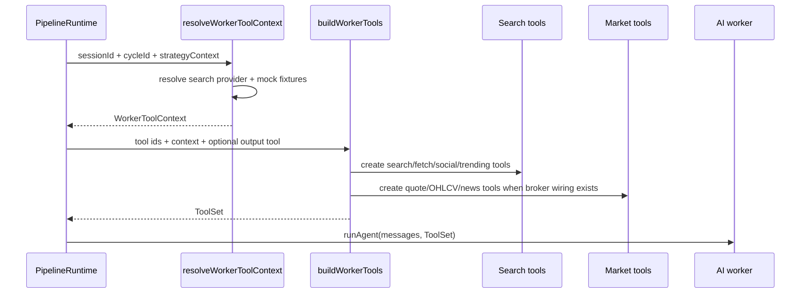

# pipeline/worker-tools

Builds the tools that AI workers can call. It turns a worker's configured tool ids into real market, search, fetch, social, trending, and submit-output functions scoped to the current session.

## How it works

- `worker-tool-factory.ts` exports `buildWorkerTools()`, which returns an AI SDK `ToolSet` for one worker call.
- Supported configured tool ids are `search_web`, `fetch_url`, `search_reddit`, `get_trending_symbols`, `get_quote`, `get_ohlcv`, and `get_news`.
- If a worker has an output schema, the factory also adds a terminal submit-output tool. The terminal tool echoes validated input so `runAIWorker()` can extract structured output from the tool call arguments.
- `search_web` uses a mock search tool in mock sessions with fixture data. Otherwise it requires a configured search provider and can fall back to a configured provider id such as built-in DuckDuckGo.
- `fetch_url`, `search_reddit`, and `get_trending_symbols` all log API-call metadata and support mock/session fixture behavior where available.
- Market tools are created only when broker routing and broker registry are available. Quote, OHLCV, and news calls route through the broker/search setup for the session and enabled instrument class.
- `worker-tool-resolver.ts` builds the `WorkerToolContext` once per run from session repo, workspace preferences, API call log repo, search registry, broker routing, broker registry, and strategy context.
- `resolve-search-provider.ts` chooses the session default search provider first, then the workspace default, then `null`.
- `resolve-mock-tool-context.ts` detects mock broker sessions and supplies synthetic OHLCV, news, Reddit, trending symbol, web search, URL content, primary symbols, and mock scenario metadata.
- The maximum data spend budget comes from `strategyContext.riskConfig.maxDataSpendUsd` and is passed into search/fetch tools.

## Flow

## Terms

- **WorkerToolContext** - session-scoped dependency bundle used to create tools for one worker run.
- **ToolSet** - AI SDK map of callable tool names to tool implementations.
- **terminal submit-output tool** - schema-backed tool used by a worker to submit final structured output.
- **search provider** - configured web-search backend selected from the session default or workspace default.
- **mock tool context** - fixture-backed tool data used for paper/mock sessions so the model can still exercise quote, news, search, and discovery flows.
