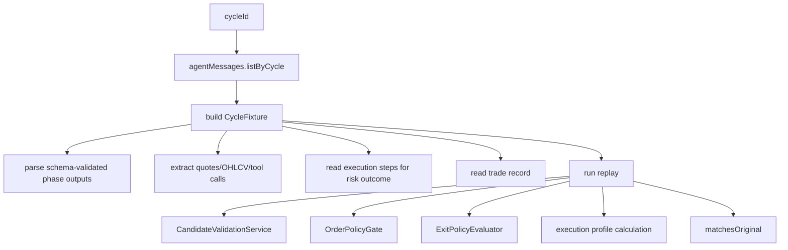

# replay

This folder lets Exva turn a historical cycle into a repeatable artifact and run the deterministic parts again. It is for debugging, acceptance tests, and checking whether today's validation and risk rules still match what happened in a saved trading cycle.

## How it works

- `cycle-replay-service.ts` builds a `CycleFixture` from persisted agent messages, trades, instrument cache rows, market snapshots, tool calls, phase traces, and execution steps.
- Fixture building starts from `agentMessages.listByCycle(cycleId)`. If no messages exist or the first strategy snapshot cannot be parsed, fixture creation returns `null`.
- The service reconstructs selected instruments from the instrument cache when the cache row belongs to the cycle, then replaces that list with selector phase output if selector output is available.
- Market data is collected from tool calls such as `get_quote`, `get_market_snapshot`, and `get_ohlcv`, plus `market_snapshot_json` stored on agent messages.
- Phase outputs are parsed and validated against the same schemas used by the pipeline: selector, technical, fundamental, review, and decision.
- Risk outcome is derived from the latest session execution step for `risk_gate`; trade outcome comes from trades associated with the cycle.
- Replay then runs deterministic services again: `CandidateValidationService`, `OrderPolicyGate`, `ExitPolicyEvaluator`, and trade execution profile calculation.
- The replay result reports whether the recomputed risk outcome and trade-opened state match the original fixture, plus scorecard details such as whether submission fired and rough sizing-field authorship.
- Replay is offline. It should not place broker orders, call live brokers, or mutate the original historical session state.

## Flow

## Terms

- **CycleFixture** — serialized snapshot of one historical cycle's inputs, AI outputs, market data, risk outcome, and trade result.
- **ReplayResult** — deterministic recomputation result plus comparison against the original cycle.
- **Phase output** — parsed AI output for selector, technical, fundamental, review, or decision.
- **Phase trace** — saved tool-call trace for an AI phase.
- **matchesOriginal** — booleans showing whether recomputed risk/trade-opened outcomes align with the historical run.
