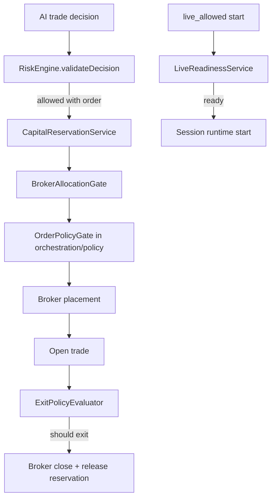

# risk

This folder is the deterministic safety layer around trading. It sizes down or blocks risky decisions, reserves capital so concurrent flows cannot overcommit the same dollars, evaluates exits for open trades, checks broker allocation, and decides whether a live session is ready to start.

## How it works

- `risk-engine.ts` checks session-level limits and decision-level order risk. It blocks when API spend, daily loss, or profit-target limits are hit; rejects zero-size orders; rejects when concurrent trade caps are reached; reduces oversized positions to configured max size; reduces prediction-market exposure to max exposure; and blocks low-confidence decisions below the wait-for-open threshold.
- `RiskEngine.validateDecision` returns the possibly reduced `OrderRequest` as `value` when allowed. Callers must use that returned order, not the original order, because risk may have lowered size.
- `capital-reservation-service.ts` wraps the capital reservations repo. It reserves for auto-approved orders or pending approvals, converts approval reservations to open orders, converts open orders to positions, releases on approval rejection/cancel/failure/close, and lists active reservations by session.
- `broker-allocation-gate.ts` checks whether an order fits the session's allocation for the chosen broker and whether the same symbol is already held on that broker by another session. Allocation enforcement can be hard or warn-only through workspace preferences or broker account settings.
- `exit-policy-evaluator.ts` decides whether an open non-prediction trade should exit because of take profit, fixed percentage stop, or trailing ATR stop. Prediction markets are skipped here because lifecycle handles prediction-market resolution/exposure separately.
- ATR exits need at least 15 bars for the default 14-period ATR calculation. If bars are unavailable or insufficient, ATR exit simply does not fire for that tick.
- `live-readiness-service.ts` is the stricter gate for `live_allowed` sessions. It requires live execution mode, at least one broker assignment, live broker accounts, passing broker connection tests, launch-capable adapters, and an explicit user acknowledgement.
- `index.ts` exports the core risk engine, capital reservation service, and broker allocation gate for callers.
- Risk services should remain deterministic and explainable. They should produce specific reasons and codes because failures are surfaced to operators, replay, scorecards, and execution-step history.

## Flow

## Terms

- **Risk engine** — deterministic checker that blocks or adjusts orders based on session config, stats, confidence, and exposure.
- **Capital reservation** — persisted hold on dollars for an approval, open order, or open position.
- **Allocation enforcement** — broker/session allocation rule that either hard-blocks oversize orders or allows them with a warning.
- **Live readiness** — live-only startup gate requiring real broker readiness plus user acknowledgement.
- **Exit policy** — configured stop/take-profit/trailing rule used to close open trades.
- **ATR** — average true range, a volatility measure used for trailing stops.
