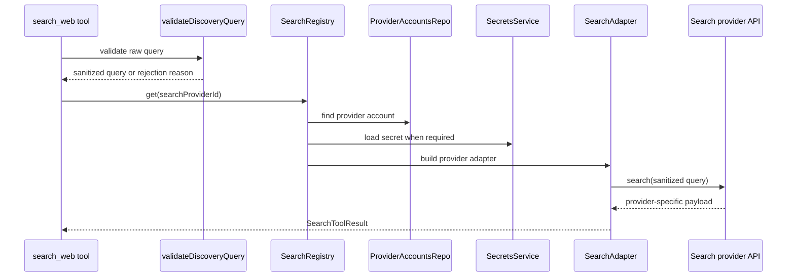

# search

This folder is the web-search provider boundary for AI workers. Workers ask for normalized search results through `search_web`; this service chooses the configured backend, checks credentials, sanitizes risky or useless queries, and returns one common result shape no matter which provider answered.

## How it works

- `search-types.ts` defines the common `SearchToolResult` shape returned to tools and model workers: result URL, title, snippet, optional published date, query, provider type, credits used, and optional cache timestamp.
- `SearchRegistry` in `search-registry.ts` resolves a saved search provider account to a concrete `SearchAdapter`. It caches adapters by provider key just like the LLM provider registry.
- Search accounts must be configured and must have `category === "search"`. Missing or unconfigured accounts fail with `SEARCH_PROVIDER_REQUIRED`.
- Built-in providers such as DuckDuckGo do not require secrets. Brave, Tavily, and MCP-backed providers can require secrets from `SecretsService` depending on the account type.
- MCP search providers require `metadata.baseUrl`; optional metadata can also select the MCP tool name used by the adapter.
- `sanitize-search-query.ts` strips model filler phrases, trims quotes, collapses whitespace, and caps web-search queries at 200 characters before adapters encode them for HTTP requests.
- `validateDiscoveryQuery` is stricter than basic sanitization. It rejects empty queries, digits-only queries, tool-name queries such as `search_web`, and very short queries because selector discovery needs a real instrument, catalyst, setup, or theme.
- `normalizeQueryFamily` gives query-loop guards a stable comparison key by lowercasing and reducing punctuation/spacing.
- The search service does not expose AI SDK tools directly. Tool construction lives in `services/tools/search-tool.ts`; this folder only resolves and runs search providers.

## Flow

## Terms

- **SearchRegistry** - Resolver and cache that maps a configured search provider key to a `SearchAdapter`.
- **SearchAdapter** - Provider-specific implementation with `search(query)` and `testConnection()`.
- **SearchToolResult** - Normalized result payload returned to tools and model workers.
- **Built-in search provider** - Search account type that does not require a secret, currently used for DuckDuckGo-style local/no-key search.
- **Discovery query** - A selector-phase query intended to find instruments, catalysts, setups, or themes rather than generic browsing content.
- **Normalized query family** - Lowercase punctuation-stripped query string used to detect repeated search behavior.
