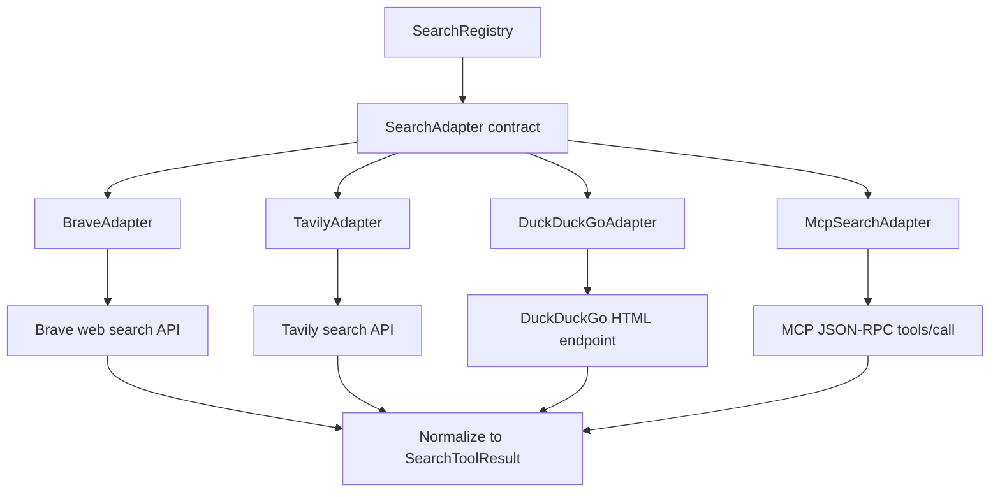

# search/adapters

These adapters are the concrete web-search backends behind Exva's normalized search service. Each file knows one provider's HTTP protocol and response shape, then converts it into the same `SearchToolResult` structure for AI workers.

## How it works

- `search-adapter.ts` re-exports the shared `SearchAdapter` and `SearchToolResult` types from `search-types.ts` so callers inside this folder can import the provider contract locally.
- `brave-adapter.ts` calls Brave Web Search with `X-Subscription-Token`, retries only `429` responses with short backoff, joins the title and description into a snippet, preserves Brave age/page-age as `publishedDate`, and charges `creditsUsed: 1`.
- `tavily-adapter.ts` POSTs to Tavily with `search_depth: "advanced"`, `max_results: 7`, no answer, and no raw content. It retries `429` responses and caps long result content before returning normalized snippets.
- `duckduckgo-adapter.ts` fetches DuckDuckGo's HTML endpoint without an API key, parses result blocks from HTML, decodes common HTML entities, unwraps `uddg` redirect URLs, returns up to five results, and reports `creditsUsed: 0`.
- `mcp-adapter.ts` calls an MCP server using JSON-RPC `tools/call`. It requires `metadata.baseUrl`, uses `metadata.mcpToolName` or `search`, sends a bearer token when a secret exists, and adapts strings, arrays, objects, or `results` arrays into normalized search results.
- Each adapter exposes `testConnection()` by running a small real query and returning `{ ok, error }` instead of throwing to UI/configuration code.
- Provider failures are converted to `AppError` with `PROVIDER_UNREACHABLE` where possible so callers can distinguish provider outages from local validation/configuration problems.
- Snippet clamping happens in adapters because provider payload size varies. Tavily allows longer content snippets than Brave/DuckDuckGo/MCP because it can return article-like summaries.
- These files should not decide which provider to use. `SearchRegistry` owns provider selection, account validation, secret loading, and adapter caching.

## Flow

## Terms

- **SearchAdapter** - Common interface implemented by all search backends.
- **SearchToolResult** - Provider-neutral payload containing results, provider id, credits, and cache metadata.
- **MCP search provider** - External MCP server that exposes a search-like tool over JSON-RPC.
- **`metadata.baseUrl`** - Required search-provider metadata field for MCP search accounts.
- **`metadata.mcpToolName`** - Optional MCP metadata field selecting which remote tool to call; defaults to `search`.
- **`creditsUsed`** - Provider cost counter returned with each search result. It is zero for DuckDuckGo and MCP, one for Brave and Tavily.
