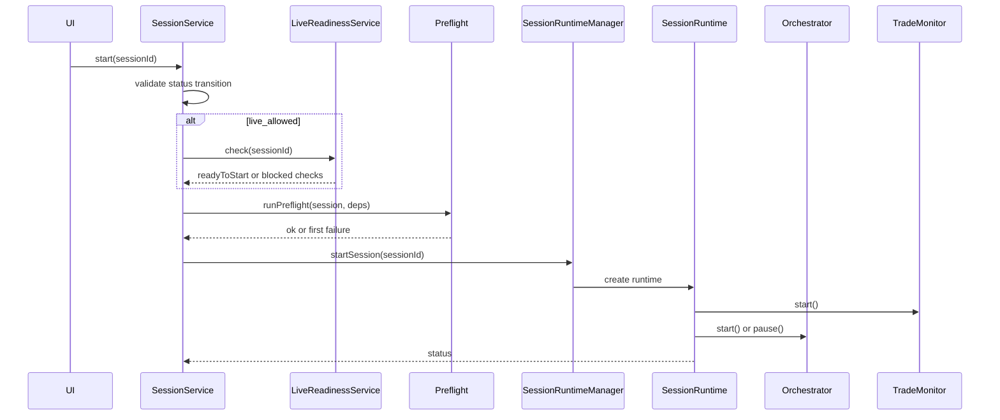

# session

This folder owns the user's trading session as an application object. It creates and edits sessions, resolves their strategy configuration, starts and stops their runtime, and blocks startup when the session is not safe or complete enough to run.

## How it works

- `session-service.ts` is the lifecycle API. It starts, pauses, resumes, stops, reports status, calculates runtime uptime, and reads live portfolio value from assigned launch-capable broker accounts.
- `SessionService.start()` handles the full startup gate: status transition validation, live-readiness checks for `live_allowed` sessions, preflight checks for all sessions, runtime startup, and session events for success/failure.
- `session-runtime-manager.ts` owns the in-memory `SessionRuntime` map. It builds `OrchestratorDeps`, creates the orchestrator and trade monitor, sets runtime bus status, rehydrates paused/active sessions from DB, forwards approval rechecks, and routes step retry/pause-after-current-step requests.
- Rehydration is deliberately conservative. Previously active sessions are demoted to paused on process startup, but their trade monitor is started so open positions remain managed. The operator must explicitly resume to allow new intake.
- `session-runtime.ts` serializes runtime lifecycle operations through a `PQueue`. The trade monitor starts in both active and paused modes; the orchestrator only opens new cycles when active.
- `session-strategy-context-service.ts` reads and saves strategy subdocuments: research posture, rules, risk config, timeframe config, AI settings, selector settings, providers, and AI phase/worker overrides. It validates through shared domain rules and blocks edits to non-editable sessions.
- `write-service.ts` creates and updates task-boundary fields and side tables. It validates unique names, instrument scope, execution mode, broker assignment mode, broker support for selected instrument classes, and instrument-class overrides.
- `template-service.ts` creates, validates, applies, and builds session templates. Applying a template clears broker/provider references that no longer exist instead of silently preserving stale IDs.
- `listing-service.ts` produces the session list view with filters, focused-session state, assigned capital, broker count, open trade count, and runtime uptime.
- `effective-instrument-classes.ts` resolves the actual enabled classes from session scope, selector settings, and assigned broker support.
- `environment-scope.ts` maps workspace environment mode to execution-mode and broker-mode filters so paper/live views stay separated unless explicitly overridden.
- `preflight/` contains startup checks that must pass before a runtime is allowed to open the orchestrator.

## Flow

## Terms

- **Session** — persisted trading workspace with objective, instrument scope, execution mode, broker assignments, and strategy configuration.
- **Runtime** — in-memory object that connects a session to its orchestrator and trade monitor.
- **OrchestratorDeps** — dependency bundle passed from session runtime management into live trading orchestration.
- **Preflight** — startup validation that runs before a session can become active.
- **Live readiness** — stricter live-only gate requiring live-mode brokers, launch-capable adapters, successful connection tests, and explicit user acknowledgement.
- **Task boundary** — core session identity and scope fields that define what the session is allowed to trade.
