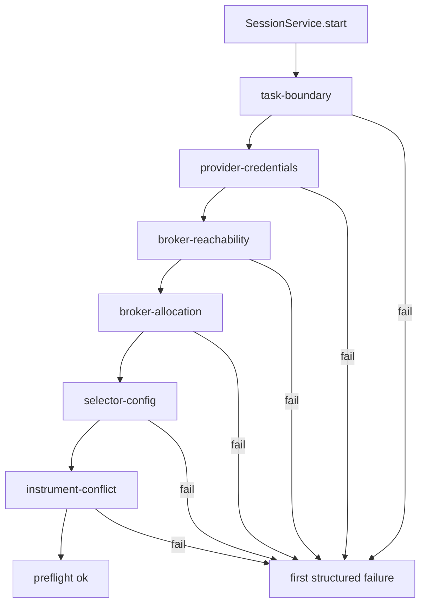

# session/preflight

Runs the checks that must pass before a session can start. This folder is the guardrail layer that catches missing credentials, broker mismatches, selector misconfiguration, and other startup blockers early.

## How it works

- `index.ts` runs checks in a fixed order and stops on the first failure. The result includes the failing check name, app error code, message, and optional details.
- `task-boundary-check.ts` verifies basic session shape: name, objective, effective instrument classes, instrument scope, and execution mode.
- `provider-credentials-check.ts` validates every configured AI phase has a provider key, an existing provider account, AI category, configured credentials, and a selected model id.
- `broker-reachability-check.ts` validates broker assignments, broker existence, overlap with effective instrument classes, route resolution for every instrument class, and `adapter.testConnection()` for each assigned broker.
- `broker-allocation-check.ts` refreshes balances for assigned brokers and asks `BrokerCapitalService` whether the session fits available broker capacity and active-session caps.
- `selector-config-check.ts` only applies when AI-selected universe is enabled. It requires a configured search provider and a configured selector AI phase/provider/model.
- `instrument-conflict-check.ts` only applies to manual shortlist sessions. It parses newline- or comma-separated symbols and rejects startup if another active session already holds the same symbol on the broker used for that instrument class.
- Checks are deliberately small and explicit so startup failure messages point to the actual operator action: connect a provider, assign a broker, pick a model, fix routing, clear a conflict, or adjust allocation.
- Preflight is not a substitute for live readiness. Live sessions pass through live readiness first and then these checks.

## Flow

## Terms

- **Preflight check** — validation that must pass before a session runtime is allowed to start.
- **Effective instrument classes** — the actual classes resolved from session settings and assigned brokers.
- **Manual shortlist** — selection mode where `instrumentScope` is parsed into explicit symbols.
- **AI-selected universe** — selection mode where selector workers discover candidates and require search/provider configuration.
- **First failure** — preflight behavior that returns immediately on the earliest failed check instead of collecting all failures.
