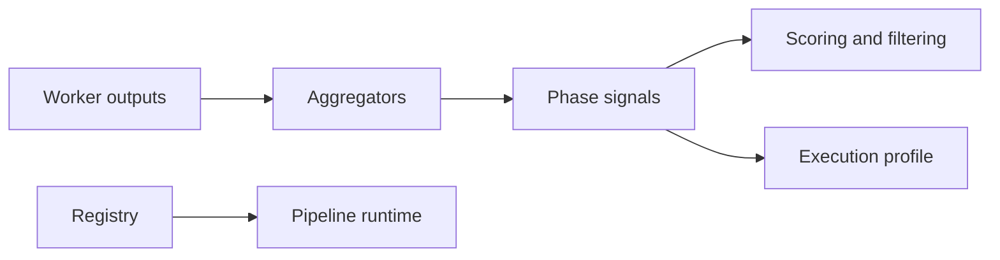

# signal

Deterministic logic that runs around or after AI work. It merges worker outputs, scores selector candidates, computes execution profiles, and hosts engine definitions the pipeline can call without touching an LLM.

## Technical

- `aggregators/` merge worker JSON into phase signals.
- `scoring/` ranks and filters selector candidates.
- `execution/` computes trade execution profiles from decision and risk inputs.
- `registry/` registers `SignalEngineDefinition` bindings for deterministic pipeline steps.

## Flow

## Terms

- **SignalEngine** — deterministic function injected into worker prompts or run as analysis steps.
