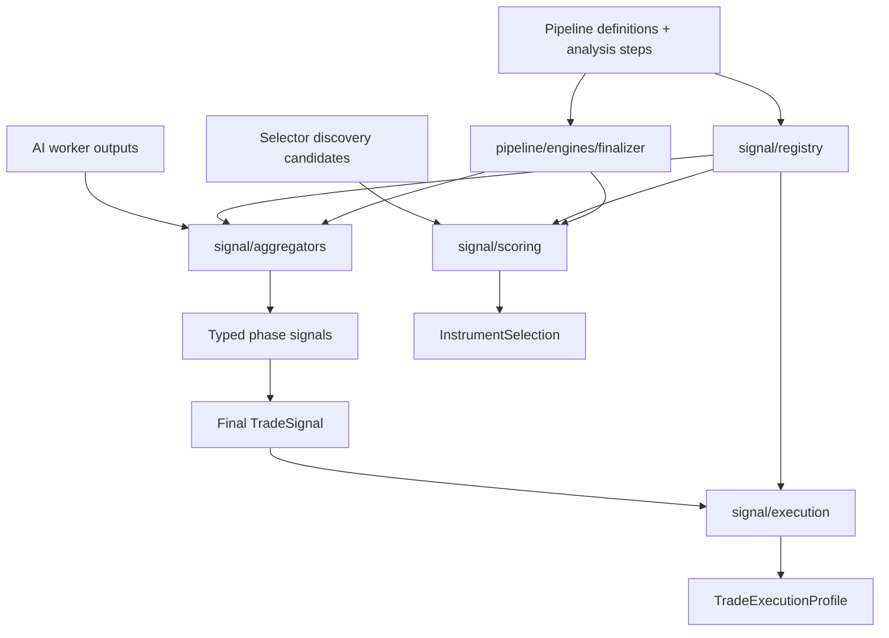

# signal

This folder is where Exva turns model-written evidence into deterministic trading signals and execution inputs. AI workers can describe what they see, but this code performs the repeatable merging, scoring, filtering, and profile calculation that should not depend on another LLM call.

## How it works

- `aggregators/` merges multiple worker outputs into typed phase signals. Technical, fundamental, review, and final trade-signal phases each have deterministic aggregation rules and shared schemas.
- `scoring/` processes selector candidates before full trade analysis. It deduplicates candidates across discovery batches, computes weighted scores, applies risk filters, builds the final instrument-selection payload, and can fetch prediction-market candidates from a discovery-capable broker adapter.
- `execution/` turns an approved `TradeSignal` plus risk/session settings into a `TradeExecutionProfile`, including side, position size, order type, limit price, stop-loss percent, and take-profit percent.
- `registry/` registers deterministic signal engines by id so pipeline code can reference them through `ENGINE_BINDINGS` or instrument-analysis engine steps. Phase finalizer engines in `pipeline/engines/finalizer/` wrap these functions for the definition-first pipeline.
- Signal code should be deterministic and local. It can read input state, run pure calculations, invoke injected policy/risk services through registered engines, or use broker discovery where explicitly wired, but it should not prompt an LLM or make provider-model calls.
- Signal code is downstream from worker execution. It assumes AI workers have already produced schema-shaped JSON, and its job is to normalize, combine, score, reject, or reshape that data into the next pipeline state.
- Two registries exist: `signal/registry/` (deterministic engine functions for aggregation, scoring, execution, policy) and `pipeline/engines/` (phase orchestration hooks that call into signal code). Do not confuse them.
- Errors here are meaningful because they indicate invalid pipeline state or impossible execution input. For example, execution-profile calculation throws when asked to compute an order profile for a `skip` signal.

## Flow

## Terms

- **Signal** - Typed, normalized output used by later pipeline steps. Examples include `TechnicalSignal`, `FundamentalSignal`, `ReviewSignal`, and `TradeSignal`.
- **Signal engine** - Registered deterministic function in `signal/registry/` that the pipeline can call by id through `ENGINE_BINDINGS` or instrument-analysis engine steps.
- **Phase finalizer engine** - Orchestration hook in `pipeline/engines/finalizer/` that wraps a signal aggregator/scoring function for use by `AIPhaseRunner`.
- **Aggregator** - Function that merges one phase's worker outputs into a single signal.
- **Selector candidate** - Instrument proposed during discovery before it has survived scoring and risk filtering.
- **Execution profile** - Deterministic order-shape output derived from a non-skip trade decision and risk configuration.
- **Deterministic step** - Pipeline step whose output should be reproducible from the same inputs without calling an LLM.
