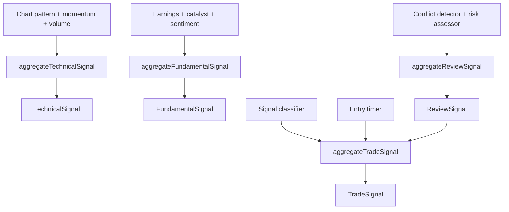

# signal/aggregators

Aggregators take the separate JSON outputs from parallel AI workers and collapse them into one clean signal for the next phase. They are the deterministic referee between many specialist observations and the single typed object the pipeline carries forward.

## How it works

- `technical-aggregator.ts` combines chart-pattern, momentum, and volume worker outputs into a `TechnicalSignal`. It preserves support/resistance, pattern details, momentum score, volume score, and computes `timeframeAlignment` from trend direction versus volume signal.
- `fundamental-aggregator.ts` combines earnings, catalyst, and sentiment worker outputs into a `FundamentalSignal`. It derives `catalystScore` as `strength * freshness * (1 - contradictionRisk)` when enough catalyst inputs exist.
- `review-aggregator.ts` combines conflict and risk assessor outputs into a `ReviewSignal`. It derives a recommendation of `proceed`, `reduce_size`, or `skip` from conflict level and overall risk.
- `trade-signal-aggregator.ts` combines the review signal, classifier output, and entry-timer output into a final `TradeSignal`. Review `skip`, missing classifier output, timer `skip`, or timer `wait` can all force the final action to `skip`.
- Each worker output schema is defined next to the aggregator that consumes it. This keeps worker output expectations close to the deterministic merge logic.
- Aggregators parse their output through shared trade-signal schemas from `@electron/shared/ai/trade-signals`, so invalid merged state fails immediately instead of drifting through the pipeline.
- Raw worker summaries are preserved by concatenating labeled summary fragments such as `Momentum: ...`, `Catalyst: ...`, or `Risk: ...`. The resulting signal keeps enough context for audit/debugging without preserving every worker detail.
- Aggregators do not call providers, brokers, search, or the database. They should remain pure transformations of already-collected worker output and current phase state.
- Trade-phase aggregators are invoked by phase finalizer engines in `pipeline/engines/finalizer/` (e.g. `technical-aggregator.ts` calls `aggregateTechnicalSignal` from this folder). The signal registry also registers transformer engines with the same ids for legacy `ENGINE_BINDINGS` and effective-config metadata.

## Flow

## Terms

- **Worker output** - Schema-shaped JSON emitted by one AI worker in a phase.
- **Phase signal** - The merged typed result for a phase, produced after all relevant workers finish.
- **Timeframe alignment** - Technical score showing whether trend and volume direction agree.
- **Catalyst score** - Fundamental score derived from catalyst strength, freshness, and contradiction risk.
- **Review recommendation** - Deterministic review outcome: `proceed`, `reduce_size`, or `skip`.
- **Entry timer** - Worker output that says whether entry timing is `now`, `wait`, or `skip` and may provide a limit price.
