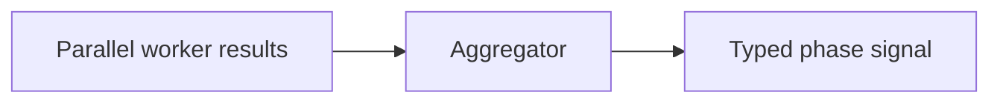

# signal/aggregators

Combines several worker outputs into one clean phase signal. The pipeline uses these aggregators after a batch of parallel workers finishes.

## Technical

- One aggregator per major output family: technical, fundamental, review, and trade signal.
- Aggregators are deterministic and schema-shaped; they never call external services.

## Flow

## Terms

- **Phase signal** — the merged structured output for one pipeline phase.
