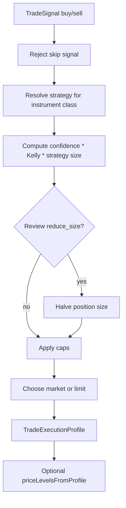

# Deprecated path

`trade-execution-profile` moved to `electron/main/services/orchestration/trade-execution-profile.ts`.
A shim re-export remains at `./trade-execution-profile.ts` for import compatibility.

---

# signal/execution

This folder turns a non-skip trade decision into the order-shape details needed before policy gates and broker placement. It does not place orders; it calculates the deterministic execution profile from the signal, instrument class, exposure caps, confidence, and risk settings.

## How it works

- `trade-execution-profile.ts` currently owns the execution-profile calculation.
- `computeTradeTradeExecutionProfile` accepts a `TradeSignal`, instrument class, max position size, optional max exposure, risk settings, and optional review recommendation.
- A `skip` signal is invalid for execution-profile calculation and throws immediately. Upstream code must only request an execution profile after the final signal has chosen `buy` or `sell`.
- Execution strategy is validated against the instrument class. If the signal's strategy does not fit the class, the calculator falls back to the first valid strategy for that class.
- Position size is based on `maxPositionUsd * confidence * kellyFraction * strategy.sizeFactor`, capped by `maxPositionUsd` and optionally `maxExposureUsd`.
- Prediction-market sizing treats `maxExposureUsd` as a hard cap when present, then applies Kelly fraction, confidence, and strategy factor.
- A review recommendation of `reduce_size` halves the computed position before final caps are applied.
- `side` maps directly from signal action: `buy` becomes `BUY`; `sell` becomes `SELL`.
- Order type is `limit` when the signal includes `entryPrice`; otherwise it is `market`. The profile carries the limit price through unchanged.
- Stop-loss and take-profit percentages are scaled by the selected strategy profile. The current profiles all use factor `1`, but the structure allows strategy-specific risk scaling.
- `priceLevelsFromProfile` converts stop-loss and take-profit percentages into concrete prices when an entry price is available. BUY and SELL directions invert the stop/target math correctly.

## Flow

## Terms

- **TradeExecutionProfile** - Deterministic output containing position size, side, stop/take percentages, order type, and optional limit price.
- **Execution strategy** - Trade setup category from the final signal, such as `trend_momentum`, `breakout`, `mean_reversion`, `event_driven`, `arbitrage`, `prediction_market`, or `futures_trend`.
- **Kelly fraction** - Risk sizing multiplier clamped between 0 and 1 before sizing.
- **Max position** - Per-trade dollar cap.
- **Max exposure** - Optional broader exposure cap, especially important for prediction markets.
- **Limit price** - Explicit entry price from the signal. Its presence makes the order profile a limit order.
