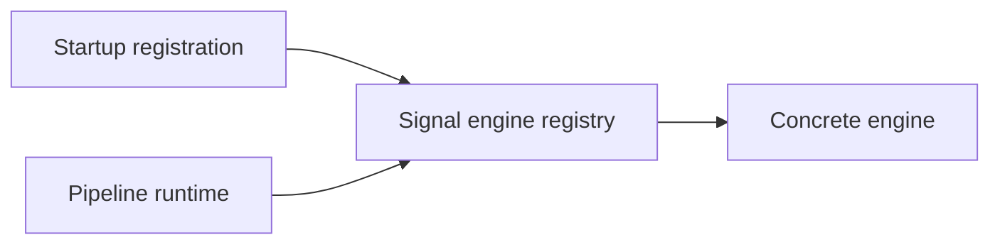

# signal/registry

Registers the deterministic signal engines the pipeline can call by id. This is the bridge between declarative analysis steps and the concrete TypeScript functions that do the work.

## Technical

- `signal-engine-registry.ts` stores engine definitions.
- `register-default-engines.ts` and `register-trade-signal-engines.ts` wire the built-in engines at boot.
- `types.ts` defines `SignalEngineDefinition` and `SignalEngineContext`.

## Flow

## Terms

- **Signal engine** — deterministic function that runs as a pipeline step or finalize binding.
