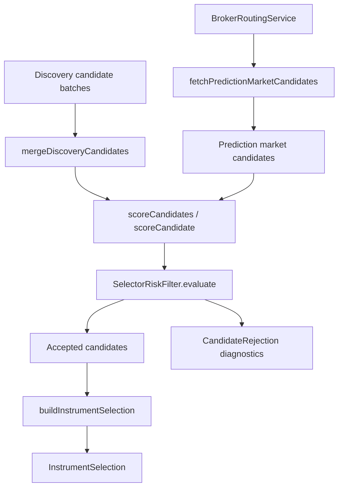

# signal/scoring

This folder is the deterministic filter between raw selector discovery and full trade analysis. It merges duplicate instrument ideas, assigns comparable scores, rejects candidates that fail session/risk requirements, and shapes the final selection payload that the rest of the trading loop can analyze.

## How it works

- `selector-candidate-merger.ts` deduplicates discovery candidates by `instrumentClass:symbol`. When multiple workers find the same instrument, it keeps the strongest nullable score values, fills missing descriptive fields from later candidates, unions sources and risk flags, and appends selector traces.
- `selector-scoring-engine.ts` computes `finalScore` from hype, volume, catalyst, and liquidity scores using configurable weights from `@electron/shared/ai/ai-phase-config`. If total weight is zero or negative, the score is zero.
- `selector-risk-filter.ts` applies deterministic acceptance rules after scoring. It checks enabled instrument classes, minimum final score, non-empty rationale, broker route availability when routing is injected, presence of a valid `get_quote` trace, and `CandidateValidationService` rules using strategy context.
- Risk-filter evaluation returns both accepted candidates and structured `CandidateRejection` diagnostics. The simpler `filter` method returns only accepted candidates.
- Quote validation is trace-based. The filter scans selector tool traces for `get_quote`, parses the tool result JSON, and requires at least a numeric price plus timestamp before candidate validation can pass.
- `selector-submission-builder.ts` converts the top `maxCount` candidates into `InstrumentSelection`. It carries symbol, class, display name, optional metadata from catalyst summary, rationale, and optional selector evidence.
- `prediction-market-candidate-engine.ts` asks the broker routing service for a prediction-market adapter that supports market discovery, fetches Polymarket-style rows, validates condition/question/token data, emits YES and NO token candidates, scores them by liquidity, category, and resolution time, and returns the top 20.
- Prediction-market candidates use symbols in the `pm:<conditionId>` format and put token ids, category, liquidity, resolution time, and slug into `instrumentMetadataJson`.
- Scoring code does not run AI workers. It consumes selector output and service-provided market discovery data, then returns deterministic candidate lists or selection payloads.
- Selector scoring/filtering/submission functions are invoked from two places: stage-local logic in `definitions/selector.phase.ts` (`applyResults`, `scoreSelectorCandidates`) and phase finalizer engines in `pipeline/engines/finalizer/` (`selector-risk-filter`, `selector-submission-builder`). The prediction-market input engine in `pipeline/engines/input/prediction-market-candidates.ts` calls `fetchPredictionMarketCandidates` from this folder.

## Flow

## Terms

- **Selector candidate** - Instrument idea emitted by selector discovery workers before final selection.
- **Final score** - Weighted average of hype, volume, catalyst, and liquidity scores.
- **Risk filter** - Deterministic candidate gate that rejects candidates failing configured or session-derived rules.
- **Candidate rejection** - Diagnostic record explaining why a candidate did not survive selection.
- **Selector trace** - Tool-call trace attached to a candidate; used to prove the selector actually verified quote data.
- **InstrumentSelection** - Final payload of selected instruments sent to later analysis/trading-loop steps.
- **Prediction-market candidate** - YES or NO outcome token candidate derived from a prediction-market discovery adapter.
