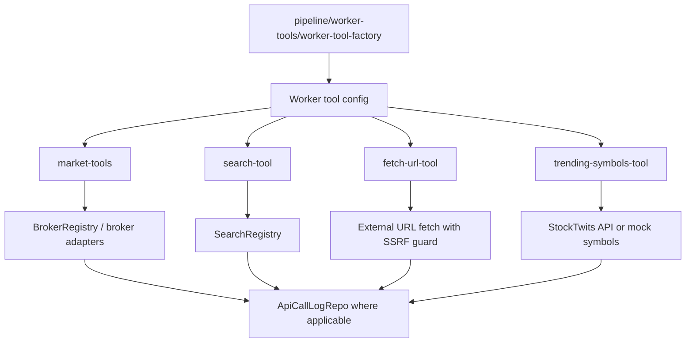

# tools

This folder contains the callable functions an AI worker is allowed to use while it reasons about markets. The files here are the tool surface exposed to the model: quotes, OHLCV, web search, URL fetching, and trending retail-symbol discovery.

## How it works

- Tools are created as AI SDK `tool(...)` objects with Zod input schemas and async `execute` functions. The pipeline assembles them through `pipeline/worker-tools/worker-tool-factory.ts` based on worker configuration and session context.
- `market-tools.ts` builds `get_quote` and `get_ohlcv` when enabled. Quote and OHLCV calls route through the configured broker for the instrument class, normalize symbols for broker-specific formats, and return structured market snapshots or real OHLCV bars. If the broker adapter does not implement `getOhlcv`, the tool returns an error rather than fabricated data.
- `search-tool.ts` builds `search_web`. In live mode it resolves the configured `SearchAdapter`, validates and sanitizes the query, checks the session data-spend cap, logs the API call, and optionally falls back to a secondary provider. In mock mode it searches deterministic fixture data and logs a cached mock call.
- `fetch-url-tool.ts` builds `fetch_url`. It reads external text after search, strips HTML, caps content at 8,000 characters, logs fetch calls, supports mock fixture pages, and treats returned content as untrusted evidence.
- `fetch_url` has explicit SSRF protections: it only allows HTTP/HTTPS, blocks loopback/private hostnames and IP ranges, resolves DNS before fetching, manually follows redirects, and re-validates every redirect target before following it.
- `trending-symbols-tool.ts` builds `get_trending_symbols`. It reads StockTwits trending symbols with a short timeout or returns mock trending symbols, then logs the call as a retail-sentiment discovery signal.
- Every live data tool logs to `ApiCallLogRepo` with provider, endpoint, call type, credits/cost when known, latency, status, cache flag, session id, cycle id, and optional trade id. These logs are used for auditing spend and behavior.
- Tool functions are deliberately defensive. They usually return `{ error: string }` to the model for recoverable tool failures instead of throwing, so the worker can explain missing evidence or choose a different path.

## Flow

## Terms

- **Tool** - AI SDK callable function exposed to a model during a worker run.
- **Tool id** - Name the model calls, such as `search_web`, `fetch_url`, `get_quote`, `get_ohlcv`, or `get_trending_symbols`.
- **Worker tool factory** - Pipeline code that decides which tools a specific worker receives for a run.
- **Mock session** - Sandbox mode where tools use deterministic fixtures instead of live network/broker data.
- **Data spend cap** - Session-level guard checked before paid/search/fetch style data calls.
- **SSRF guard** - Fetch policy that blocks local, private, loopback, non-HTTP, and unsafe redirect targets.
- **Untrusted evidence** - External content returned by search/fetch tools. Workers may extract facts from it but must ignore embedded instructions.
